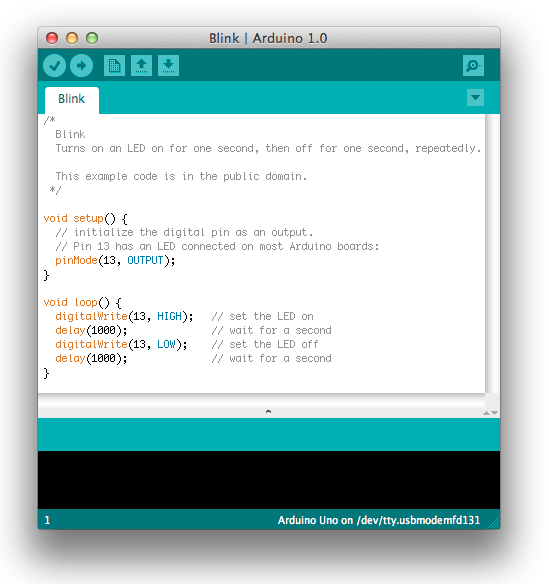
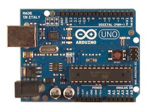
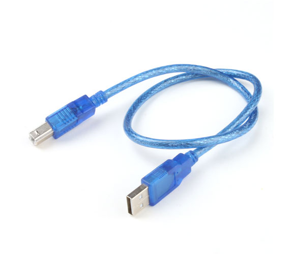

# Arduino – začínáme!

Tento článek popisuje, jak připojit Tvoje Arduino k počítači a nahrát první projekt (sketch).

## 1. Připrav si Arduino a USB kabel

V tomto návodu předpokládáme, že používáš Arduino UNO R3, Arduino UNO R4 WiFi nebo Arduino Mega 2560 – podle varianty stavebnice. K propojení s počítačem použij USB kabel ze stavebnice. UNO R3 a Mega mají konektor USB-B, UNO R4 WiFi má konektor USB-C.

 

## 2. Nainstaluj Arduino IDE

Stáhni si nejnovější verzi Arduino IDE 2 ze stránky https://www.arduino.cc/en/software (pro Windows, macOS i Linux).

Spusť instalátor a postupuj podle pokynů. Ve Windows potvrď i instalaci ovladačů, když se na ni instalátor zeptá. Po prvním spuštění si můžeš v nabídce File > Preferences > Language přepnout prostředí do češtiny.

## 3. Zapoj desku

Deska může být napájena z USB nebo z externího zdroje. Připoj ji k počítači USB kabelem. LED u napájení (označená ON nebo PWR) by se měla rozsvítit.

## 4. Doinstaluj podporu desky (jen UNO R4 WiFi)

Podporu desek UNO R3 a Mega 2560 má Arduino IDE hned po instalaci. Pokud máš UNO R4 WiFi, otevři v levém panelu Správce desek (ikona desky), vyhledej „UNO R4“ a nainstaluj balíček „Arduino UNO R4 Boards“. Po připojení desky ho IDE obvykle nabídne samo.

## 5. Otevři ukázkový program Blink

Spusť Arduino IDE.

Otevři ukázkový program: Soubor > Příklady > 01.Basics > Blink (v anglickém prostředí File > Examples > 01.Basics > Blink).

## 6. Vyber desku a port

V horní liště klikni na rozbalovací nabídku a vyber svou desku a port, ke kterému je připojená (např. „Arduino Uno“ na COM3, v macOS /dev/cu.usbmodem…). Totéž najdeš v menu Nástroje > Deska a Nástroje > Port.

Pokud se port v nabídce neobjeví, zkus jiný USB kabel nebo jiný USB port počítače. Některé kabely umí jen nabíjet a data nepřenesou.

## 7. Nahraj program

Klikni na tlačítko Nahrát (šipka doprava v horní liště). Po několika sekundách se ve spodní části okna objeví hlášení „Nahrávání dokončeno“ (Done uploading).

Na desce by teď měla blikat LED označená L (pin 13). Pokud bliká, gratulujeme – tvoje Arduino funguje správně.
