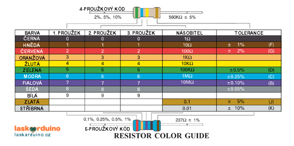

# Značení rezistorů

## Hodnoty
Rezistory (hovorově "odpory") ve stavebnici mají pět barevných proužků: tři pro číslice, čtvrtý je násobitel a pátý, trochu odsazený, udává toleranci (hnědá = 1 %). Ve stavebnici najdeš tyto hodnoty:

| Hodnota | Proužky (od kraje) | Použití |
|---|---|---|
| 220 Ω | červená – červená – černá – černá – hnědá | LED, segmentovky |
| 1 kΩ | hnědá – černá – černá – hnědá – hnědá | rezerva pro vlastní pokusy |
| 10 kΩ | hnědá – černá – černá – červená – hnědá | tlačítko, fotorezistor, senzor plamene |

Pokud si hodnotou nejsi jistý, změř ji multimetrem.

## Poznámka ke schématům

Ve schématech se typicky setkáte s jedním ze dvou značení rezistorů, a to Americkým (IEEE/ANSI) a Evropským (IEC). V tomto návodu se setkáte se značením Americkým.

