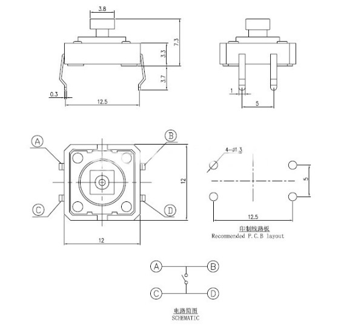
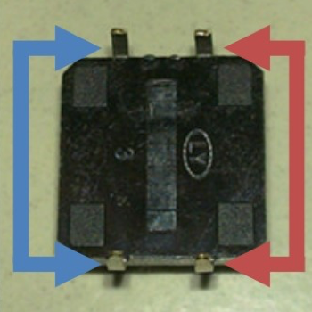
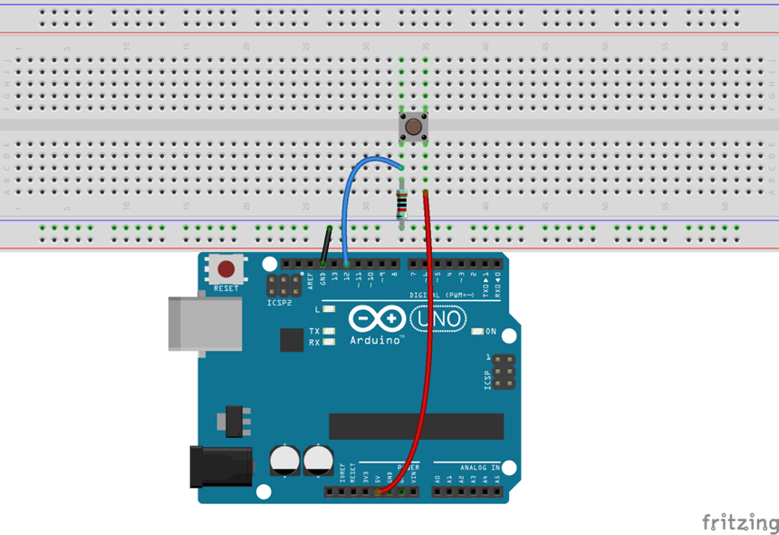
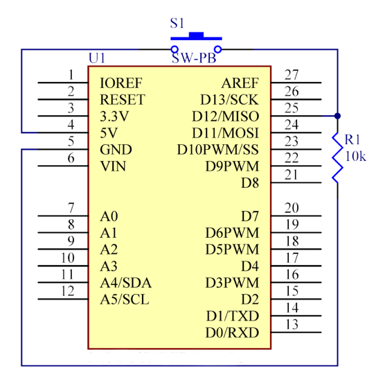

# Lekce 1: Řízení LED tlačítkem

## Úvod

V tomto experimentu se dozvíš, jak zapnout / vypnout LED pomocí I/O portu a tlačítka. "I/O port" odkazuje na výstupní a vstupní port. Zde je použit vstupní port Arduina k tomu, aby přečetl výstup z externího zařízení. Vzhledem k tomu, že samostatná deska je vybavena LED (připojenou na pinu 13), můžeš tuto LED použít pro pohodlnější provedení experimentu.

<p align="center"></p>

## Komponenty

- Arduino
- USB kabel
- Tlačítko
- Odpor (10kΩ)
- Breadboard vodiče
- Breadboard

<p align="center"></p>

## Princip

Tlačítka jsou běžnou součástí a slouží k ovládání elektronických zařízení. Jsou obvykle používána jako přepínače pro připojení nebo odpojení obvodů. Tlačítka se vyrábí v různých tvarech a velikostech, avšak zde jsme použili 12 mm tlačítko, viz následující obrázky. Piny, na které ukazují šipky stejné barvy, jsou propojeny.

Při stisknutí tlačítka se piny, na které ukazují modré šipky, připojí na piny označené červenou šipkou.

Obecně platí, že tlačítko je přímo napojeno na LED za účelem zapnutí a vypnutí LED. Toto spojení je relativně jednoduché. Někdy se ale LED rozsvítí automaticky, bez stisknutí tlačítka. To může být způsobeno různým typem rušení. Aby se zabránilo těmto vnějším zásahům, je použit pull-down rezistor pro připojení 1K–10KΩ odporu mezi tlačítkem, portem a GND. Toto se využívá k ničení vnějších zásahů, zatímco je připojeno GND tak dlouho, dokud je tlačítko vypnuté.

Toto připojení obvodu je široce používáno v řadě obvodů a elektronických zařízení. Například, pokud stiskneš jakékoli tlačítko na svém telefonu, rozsvítí se Ti podsvícení.

## Postup experimentu

**Krok 1:** Vytvoř obvod

<p align="center"> </p>

**Krok 2:** Napiš kód do Arduino IDE

**Kód** – soubor `Rizeni_LED_tlacitkem.ino`:

<!-- kod: Rizeni_LED_tlacitkem/Rizeni_LED_tlacitkem.ino -->
```cpp
/*
 * LaskaKit Arduino MAXI Starter kit – Lekce 1: Řízení LED tlačítkem
 *
 * Dokud držíš tlačítko, svítí LED na desce Arduino (pin 13).
 * Po puštění tlačítka LED zhasne.
 *
 * Zapojení:
 *   Tlačítko: jeden vývod na 5V, druhý na pin 12
 *   Odpor 10 kΩ: mezi pin 12 a GND (drží vstup v klidu na LOW)
 *   LED: vestavěná LED „L“ na pinu 13 (nic nezapojuješ)
 *
 * Knihovny: žádné (jen Arduino IDE)
 * Desky:    Arduino UNO R3, Arduino UNO R4 WiFi, Arduino Mega 2560
 *
 * Verze návodu 3.0 (10/2026)
 * LaskaKit | https://www.laskakit.cz | podpora@laskakit.cz
 */

const int tlacitkoPin = 12;  // pin, na kterém je tlačítko
const int ledPin = 13;       // vestavěná LED na desce

void setup() {
  pinMode(tlacitkoPin, INPUT);  // tlačítko je vstup
  pinMode(ledPin, OUTPUT);      // LED je výstup
}

void loop() {
  // Při stisku je na pinu 12 napětí 5 V, tedy HIGH
  if (digitalRead(tlacitkoPin) == HIGH) {
    digitalWrite(ledPin, HIGH);  // rozsvítit LED
  } else {
    digitalWrite(ledPin, LOW);   // zhasnout LED
  }
}
```
<!-- /kod -->

**Krok 3:** Zkompiluj kód

**Krok 4:** Nahraj sketch do Arduina

Nyní stiskni tlačítko a LED na Arduino se rozsvítí.
