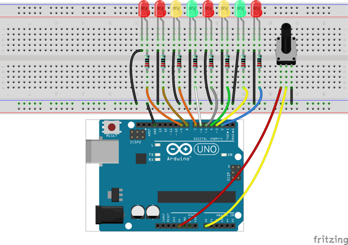
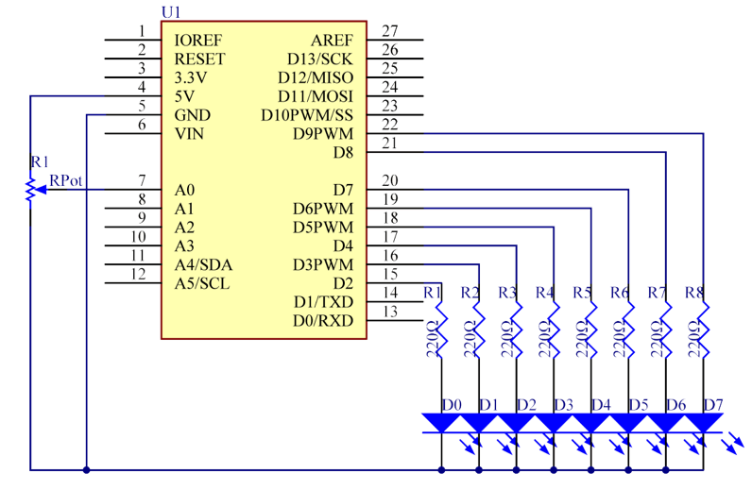

# Lekce 4: Interaktivní tekoucí LED světla

## Úvod

V minulé lekci ses už naučil, jak se dělají tekoucí LED světla. V této lekci přidáme potenciometr, který bude měnit interval blikání pomocí nastavení potenciometru.

## Komponenty

- Arduino
- Breadboard
- 8x LED
- 8x Odpor (220Ω)
- Potenciometr
- USB kabel
- Breadboard vodiče
## Princip

Princip je poměrně jednoduchý. Zapne se 8 LEDek podle pořadí. A pak se změní časový interval zapnutí a vypnutí LED pomocí nastavení potenciometru.

## Postup experimentu

**Krok 1:** Vytvoř obvod

<p align="center"> </p>

**Krok 2:** Napiš kód do Arduino IDE

**Kód** – soubor `Interaktivni_LED_tekouci_potok.ino`:

<!-- kod: Interaktivni_LED_tekouci_potok/Interaktivni_LED_tekouci_potok.ino -->
```cpp
/*
 * LaskaKit Arduino MAXI Starter kit – Lekce 4: Interaktivní tekoucí LED světla
 *
 * Světlo běhá po osmi LED tam a zpět.
 * Potenciometrem měníš rychlost běhu.
 *
 * Zapojení:
 *   8× LED přes odpor 220 Ω na piny 2 až 9, katody na GND
 *   Potenciometr: krajní vývody na 5V a GND, prostřední vývod na A0
 *
 * Knihovny: žádné (jen Arduino IDE)
 * Desky:    Arduino UNO R3, Arduino UNO R4 WiFi, Arduino Mega 2560
 *
 * Verze návodu 3.0 (10/2026)
 * LaskaKit | https://www.laskakit.cz | podpora@laskakit.cz
 */

const byte ledPiny[] = {2, 3, 4, 5, 6, 7, 8, 9};
const int pocetLed = sizeof(ledPiny);
const int potPin = A0;

int aktualniLed = 0;
int smer = 1;                    // 1 = doprava, -1 = doleva
unsigned long casZmeny = 0;

void setup() {
  for (int i = 0; i < pocetLed; i++) {
    pinMode(ledPiny[i], OUTPUT);
  }
}

void loop() {
  // hodnota 0–1023 z potenciometru = pauza v milisekundách
  unsigned long pauza = analogRead(potPin);

  // millis() vrací čas od zapnutí; LED přepneme, až uplyne pauza
  if (millis() - casZmeny >= pauza) {
    casZmeny = millis();
    posunLed();
  }
}

void posunLed() {
  for (int i = 0; i < pocetLed; i++) {
    digitalWrite(ledPiny[i], LOW);         // zhasnout všechny
  }
  digitalWrite(ledPiny[aktualniLed], HIGH); // rozsvítit aktuální

  aktualniLed += smer;
  if (aktualniLed == pocetLed - 1 || aktualniLed == 0) {
    smer = -smer;                           // na konci obrátit směr
  }
}
```
<!-- /kod -->

**Krok 3:** Zkompiluj kód

**Krok 4:** Nahraj sketch do Arduina

Nyní bys měl vidět osm LED světel, která se rozzáří jedno po druhém, podle pořadí. Nastav potenciometr a přijdeš na to, že časový interval zapnutí a vypnutí LEDek se změní.
