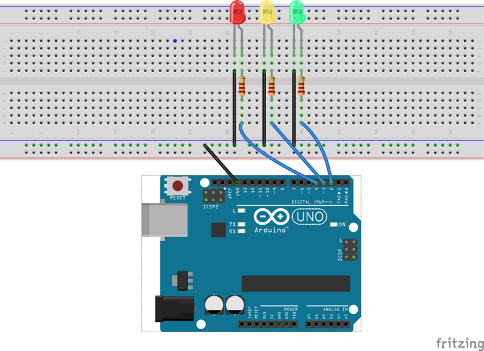
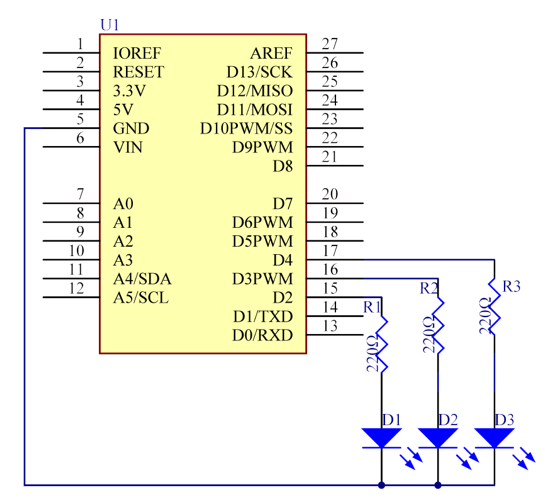
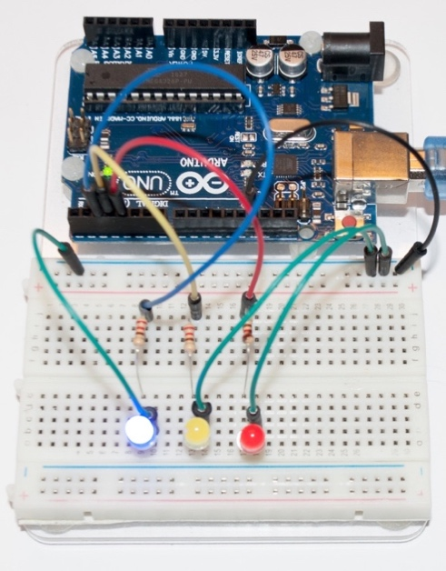
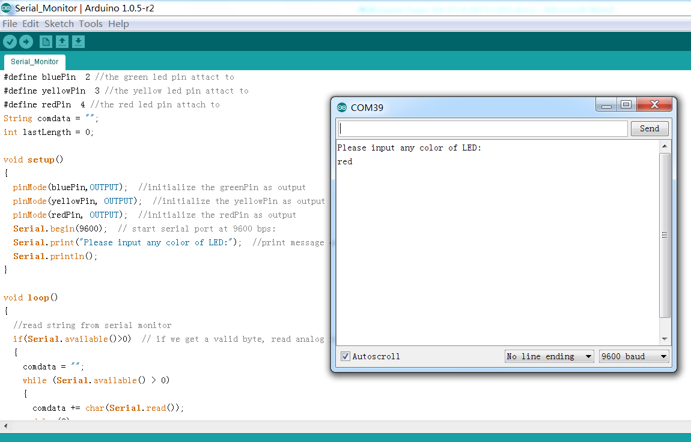

# Lekce 10: Sériový monitor

## Úvod

V této lekci se naučíme, jak zapnout a vypnout LED pomocí počítače a sériového monitoru. Sériový monitor se používá ke komunikaci mezi Arduino deskou a počítačem nebo jinými přístroji. Jedná se o zabudovaný software v Arduino prostředí a otevře se kliknutím na tlačítko v pravém horním rohu. Můžeš posílat a získávat data pomocí sériového portu na Arduino desce a ovládat desku pomocí klávesnice. V této lekci používáme 3 LED, a proto můžeš do sériového monitoru napsat červenou, žlutou nebo modrou barvu na sériový monitor v IDE. Odpovídající LED na Arduino se tímto rozsvítí.

## Komponenty

- Arduino
- Breadboard
- 3x LED
- 3x Odpor (220Ω)
- Breadboard vodiče
- USB kabel
## Princip

Zde slouží sériový monitor jako přestupní stanice pro komunikaci mezi tvým počítačem a Arduino. Nejprve převede počítač data do sériového monitoru a ta jsou poté přečtena pomocí Arduina. To pak provede další operace.

## Postup experimentu

**Krok 1:** Vytvoř obvod

<p align="center"> </p>

**Krok 2:** Napiš kód do Arduino IDE

**Kód** – soubor `Seriovy_monitor.ino`:

<!-- kod: Seriovy_monitor/Seriovy_monitor.ino -->
```cpp
/*
 * LaskaKit Arduino MAXI Starter kit – Lekce 10: Sériový monitor
 *
 * Do sériového monitoru napiš barvu a stiskni Enter:
 * „cervena“, „zluta“ nebo „modra“ – rozsvítí se příslušná LED.
 * Jiný text všechny LED zhasne.
 * Funguje s jakýmkoli nastavením konce řádku v sériovém monitoru.
 *
 * Zapojení:
 *   Modrá LED přes odpor 220 Ω na pin 2
 *   Žlutá LED přes odpor 220 Ω na pin 3
 *   Červená LED přes odpor 220 Ω na pin 4
 *   Katody všech LED na GND
 *
 * Knihovny: žádné (jen Arduino IDE)
 * Desky:    Arduino UNO R3, Arduino UNO R4 WiFi, Arduino Mega 2560
 *
 * Verze návodu 3.0 (10/2026)
 * LaskaKit | https://www.laskakit.cz | podpora@laskakit.cz
 */

const int modraPin = 2;
const int zlutaPin = 3;
const int cervenaPin = 4;

void setup() {
  pinMode(modraPin, OUTPUT);
  pinMode(zlutaPin, OUTPUT);
  pinMode(cervenaPin, OUTPUT);
  Serial.begin(9600);
  Serial.println("Napis barvu LED (cervena, zluta, modra) a stiskni Enter:");
}

void loop() {
  if (Serial.available() > 0) {
    // přečíst celý řádek a odstranit mezery a znaky konce řádku
    String prikaz = Serial.readStringUntil('\n');
    prikaz.trim();
    prikaz.toLowerCase();
    Serial.print("Prijato: ");
    Serial.println(prikaz);

    // nejdřív všechny LED zhasnout, pak rozsvítit tu správnou
    digitalWrite(modraPin, LOW);
    digitalWrite(zlutaPin, LOW);
    digitalWrite(cervenaPin, LOW);

    if (prikaz == "cervena") {
      digitalWrite(cervenaPin, HIGH);
    } else if (prikaz == "zluta") {
      digitalWrite(zlutaPin, HIGH);
    } else if (prikaz == "modra") {
      digitalWrite(modraPin, HIGH);
    } else {
      Serial.println("Neznama barva - vsechny LED zhasnuty.");
    }
  }
}
```
<!-- /kod -->

**Krok 3:** Zkompiluj kód

**Krok 4:** Nahraj sketch do Arduina

Nyní klikni na tlačítko sériového monitoru (ikona lupy) v pravém horním rohu Arduino IDE. Ve spodní části okna se otevře sériový monitor. Rychlost nastav na 9600 baud.

<p align="center"> </p>

Pomocí tohoto okénka můžeš posílat data z počítače do Arduina, ale také přijímat data a zobrazit si je na obrazovce. Po otevření se objeví výzva „Napis barvu LED“. Do řádku pro zprávu napiš cervena, zluta nebo modra (bez diakritiky) a stiskni Enter – rozsvítí se odpovídající LED. Pokud napíšeš jinou barvu, všechny LED zhasnou.

> **Tip:** Program funguje s jakýmkoli nastavením konce řádku (rozbalovací nabídka vpravo v sériovém monitoru). Doporučujeme ponechat „New Line“ (Nový řádek).
