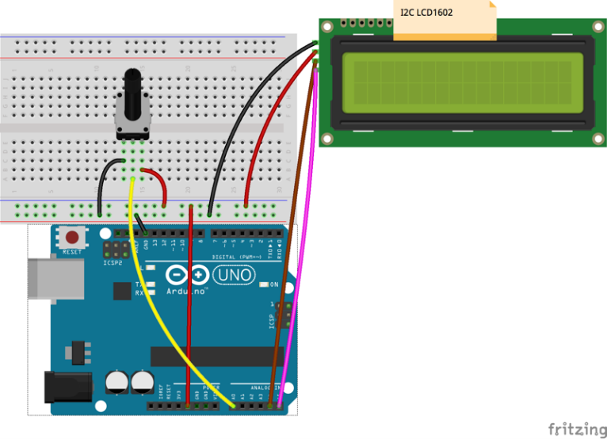

# Lekce 14: Voltmetr

## Úvod

V této lekci vytvoříme voltmetr s pomocí LCD displeje 1602 a potenciometru.

## Komponenty

- Arduino
- USB kabel
- Potenciometr
- LCD displej
- Breadboard vodiče
- Breadboard

## Princip

V tomto experimentu využijeme potenciometr k dělení napětí. Vzhledem k tomu, že Arduino umí číst pouze digitální signály, ale na výstupech posuvných pinů potenciometru je analogový signál, musíme převést tento analogový signál do digitálního s analogově-digitálním konvertorem (ADC). Naštěstí je Arduino samo o sobě dodáváno s 10bitovým ADC, které můžeme použít k provedení této konverze.

Poté se zobrazí toto napětí na LCD displeji.

## Postup experimentu

**Krok 1:** Vytvoř obvod

<p align="center"></p>

**Krok 2:** Napiš kód do Arduino IDE

**Kód** – soubor `Voltmetr.ino`:

<!-- kod: Voltmetr/Voltmetr.ino -->
```cpp
/*
 * LaskaKit Arduino MAXI Starter kit – Lekce 14: Voltmetr
 *
 * Měří napětí na jezdci potenciometru (0–5 V) a ukazuje ho na
 * displeji I2C LCD1602 i v sériovém monitoru (9600 Bd).
 *
 * Zapojení:
 *   Potenciometr: krajní vývody na 5V a GND, prostřední na A0
 *   I2C LCD1602: GND–GND, VCC–5V, SDA/SCL podle lekce 6
 *
 * Knihovny: LiquidCrystal I2C (Frank de Brabander) – Správce knihoven
 * Desky:    Arduino UNO R3, Arduino UNO R4 WiFi, Arduino Mega 2560
 *
 * Verze návodu 3.0 (10/2026)
 * LaskaKit | https://www.laskakit.cz | podpora@laskakit.cz
 */

#include <Wire.h>
#include <LiquidCrystal_I2C.h>

LiquidCrystal_I2C lcd(0x27, 16, 2);  // adresa 0x27 (nebo 0x3F, viz lekce 5)
const int merenyPin = A0;

void setup() {
  Serial.begin(9600);
  lcd.init();
  lcd.backlight();
  lcd.setCursor(4, 0);
  lcd.print("Napeti:");
}

void loop() {
  int surova = analogRead(merenyPin);       // 0–1023
  float napeti = surova * 5.0 / 1023.0;     // převod na volty

  Serial.print(napeti, 2);
  Serial.println(" V");

  lcd.setCursor(5, 1);
  lcd.print(napeti, 2);  // dvě desetinná místa
  lcd.print(" V ");      // mezera navíc smaže zbytky starého čísla
  delay(300);
}
```
<!-- /kod -->

> **Poznámka:** Potřebuješ knihovnu LiquidCrystal I2C – viz kapitola Instalace knihoven.

**Krok 3:** Zkompiluj kód

**Krok 4:** Nahraj sketch do Arduina

Nyní otoč potenciometr a uvidíš na LCD displeji napětí pinů A0 na Arduino. Toto napětí bude odpovídat změně provedené potenciometrem.
