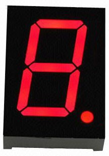
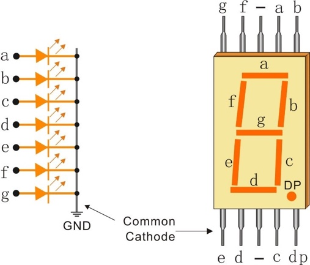
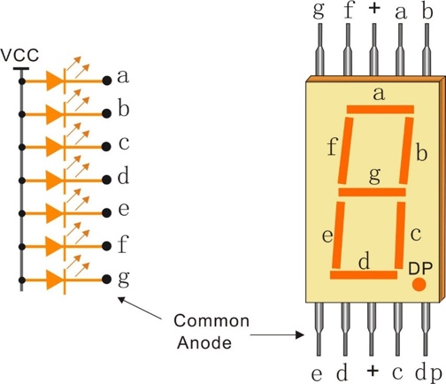
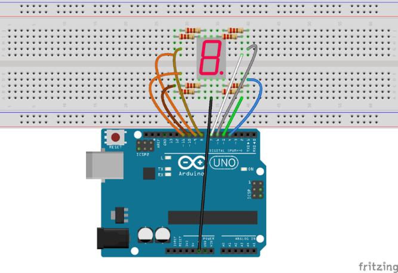
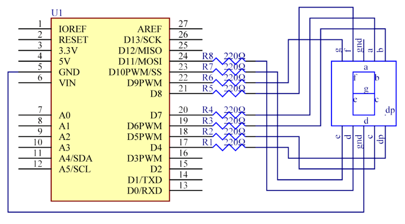

# Lekce 18: Sedmisegmentový displej

## Úvod

Sedmisegmentovka obsahuje sedm políček (segmentů), které je možné individuálně rozsvěcet a zhasínat. Jednotlivé segmenty mohou být zapnuty nebo vypnuty. Kombinací vypnutých a zapnutých segmentů můžeme docílit zobrazení arabských číslic, hexadecimálních číslic, případně i dalších písmen a znaků.

## Komponenty

- Arduino
- Sedmisegmentový displej
- 8x Odpor (220Ω)
- USB kabel
- Breadboard vodiče
- Breadboard

<p align="center"></p>

## Princip

Sedmisegmentový displej je nejpoužívanější případ segmentového displeje. Je vhodný pouze pro zobrazování číslic, maximálně hexadecimálních číslic A až F. Pro číslicový indikátor je minimální počet segmentů právě sedm. Jako ostatní segmentové displeje existují různé technologie zobrazení segmentů – LED, LCD, žárovková vlákna, dokonce i mechanické ovládání u největších displejů. Nejlevnější a nejpoužívanější z nich jsou sedmisegmentovky tvořené světelnými diodami. Ty se též vyrábějí sériově pro průmyslové použití, jsou ale i dostupné pro nadšence do elektroniky a dají se za sebou modulárně skládat do libovolně dlouhého displeje. Takový modul se familiérně nazývá sedmisegmentovka.

Diodové sedmisegmentovky mají relativně rychlou odezvu, přibližně 10 nanosekund, a spotřebu 0,5 až 1 mA proudu na jeden segment u těch nejmenších (tzn. celá sedmisegmentovka 3,5–7 mA). Napětí anody je závislé na barvě – 1,5 až 2,5 V. Aby se ovládání diod zjednodušilo, mají diody navzájem propojené anody či katody.

Společná katoda (CC) a společná anoda (CA).

Rozdíl mezi těmito dvěma displeji, jak jejich název napovídá, spočívá v tom, že společná katoda má všechny katody 7-segmentů spojených dohromady a společná anoda má všechny anody 7-segmentů spojených dohromady.

Sedmisegmentový displej se společnou katodou

Společná katoda (Common Cathode, CC) – V displeji se společnou katodou jsou všechny katody LED segmentů spojeny dohromady na log. 0. Jednotlivé segmenty (a-g) jsou osvětleny tak, že anoda segmentu je zapojena na log. 1 přes omezovací odpor.

<p align="center"> </p>

Sedmisegmentový displej se společnou anodou

Společná anoda (Common Anode, CA) – V displeji se společnou anodou jsou všechny anody LED segmentů spojeny dohromady na log. 1. Jednotlivé segmenty (a-g) jsou osvětleny tak, že katoda segmentu je zapojena na log. 0 přes omezovací odpor.

Teď je potřeba zjistit, jaký displej máš, CC nebo CA. Nejjednodušší způsob je pomocí 3V baterie CR2032. Prostřední pin na displeji je společná katoda nebo anoda. Dotkni se krátce „+“ baterie společného pinu a „−“ pinu vedle. Svítí segment? Máš displej se společnou anodou. Nesvítí? Otoč baterii a dotkni se „−“ společného pinu a „+“ pinu vedle. Svítí? Máš displej se společnou katodou. Segmentem nesviť dlouho, i vteřina trvalého svícení diodu spálí – 3 V z baterie je pro červenou LED (1,9–2 V) příliš.

## Postup experimentu

**Krok 1:** Vytvoř obvod

Tohle je přiklad zapojení pro CC displej. U CA displeje zapoj společný pin na +5V místo GND.

<p align="center"> </p>

**Krok 2:** Napiš kód do Arduino IDE

**Kód** – soubor `Sedmisegmentovy_displej.ino`:

<!-- kod: Sedmisegmentovy_displej/Sedmisegmentovy_displej.ino -->
```cpp
/*
 * LaskaKit Arduino MAXI Starter kit – Lekce 18: Sedmisegmentový displej
 *
 * Na jednomístném sedmisegmentovém displeji se postupně zobrazují
 * číslice 0 až 9.
 * Displej může mít společnou katodu (CC) nebo společnou anodu (CA) –
 * jak to zjistit, popisuje návod. Podle typu nastav řádek SPOLECNA_ANODA.
 *
 * Zapojení:
 *   Segmenty přes odpor 220 Ω: a–7, b–6, c–5, d–11, e–10, f–8, g–9, dp–4
 *   Společný vývod (prostřední pin): CC displej na GND, CA displej na 5V
 *
 * Knihovny: žádné (jen Arduino IDE)
 * Desky:    Arduino UNO R3, Arduino UNO R4 WiFi, Arduino Mega 2560
 *
 * Verze návodu 3.0 (10/2026)
 * LaskaKit | https://www.laskakit.cz | podpora@laskakit.cz
 */

// false = displej se společnou katodou (CC), true = se společnou anodou (CA)
const bool SPOLECNA_ANODA = false;

// piny segmentů v pořadí a, b, c, d, e, f, g
const int segmentPiny[7] = {7, 6, 5, 11, 10, 8, 9};
const int dpPin = 4;

// které segmenty svítí pro číslice 0–9 (pořadí a b c d e f g)
const byte cislice[10][7] = {
  {1, 1, 1, 1, 1, 1, 0},  // 0
  {0, 1, 1, 0, 0, 0, 0},  // 1
  {1, 1, 0, 1, 1, 0, 1},  // 2
  {1, 1, 1, 1, 0, 0, 1},  // 3
  {0, 1, 1, 0, 0, 1, 1},  // 4
  {1, 0, 1, 1, 0, 1, 1},  // 5
  {1, 0, 1, 1, 1, 1, 1},  // 6
  {1, 1, 1, 0, 0, 0, 0},  // 7
  {1, 1, 1, 1, 1, 1, 1},  // 8
  {1, 1, 1, 1, 0, 1, 1}   // 9
};

void setup() {
  for (int i = 0; i < 7; i++) {
    pinMode(segmentPiny[i], OUTPUT);
  }
  pinMode(dpPin, OUTPUT);
  nastavSegment(dpPin, false);  // desetinnou tečku necháme zhasnutou
}

void loop() {
  for (int c = 0; c <= 9; c++) {
    zobraz(c);
    delay(1000);
  }
}

void zobraz(int c) {
  for (int i = 0; i < 7; i++) {
    nastavSegment(segmentPiny[i], cislice[c][i]);
  }
}

// U CA displeje segment svítí při LOW, u CC při HIGH
void nastavSegment(int pin, bool sviti) {
  if (SPOLECNA_ANODA) {
    digitalWrite(pin, sviti ? LOW : HIGH);
  } else {
    digitalWrite(pin, sviti ? HIGH : LOW);
  }
}
```
<!-- /kod -->

**Krok 3:** Zkompiluj kód

**Krok 4:** Nahraj sketch do Arduina

Nyní se na displeji postupně zobrazují číslice 0 až 9. Pokud svítí obráceně (všechny segmenty kromě těch správných), máš displej se společnou anodou – v programu nastav SPOLECNA\_ANODA na true a společný pin zapoj na 5V.
