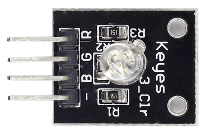
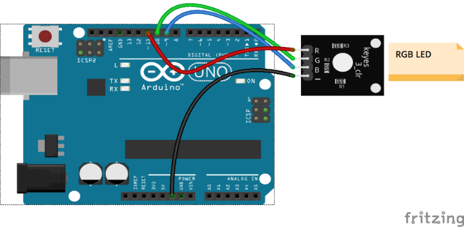

# Lekce 21: RGB LED

## Úvod

RGB LED mohou vyzařovat různé barvy světla. Tři LED: červená, zelená a modrá jsou zabaleny do průhledného nebo poloprůhledného plastového pláště se čtyřmi kolíky. Ze třech základních barev: červená, zelená a modrá lze míchat a vytvářet všechny druhy barev podle jasu, takže si můžeš udělat RGB LED vyzařující barevné světlo.

## Komponenty

- Arduino
- USB kabel
- RGB LED modul
- Breadboard vodiče

<p align="center"></p>

## Princip

V tomto experimentu budeme používat technologii PWM pro ovládání jasu RGB LED. Už jsme to popsali v lekci 2 tohoto kitu. Pokud je to pro Tebe nezbytné, zkontroluj si to.

Každá ze tří barevných kanálů: červená, zelená a modrá, má 255 stupňů jasu. Pokud ze tří základních barev jsou všechny 0, LED zhasne. Pokud jsou všechny 255, LED bude nejjasnější. Pokud do všech kolíků pustíme hodnoty mezi 0 a 255, RGB LED bude zobrazovat různé barvy.

RGB LED lze rozdělit na následující typy: společná anoda a společná katoda. V tomto experimentu budeme používat společnou katodu RGB LED.

## Postup experimentu

**Krok 1:** Vytvoř obvod

<p align="center"></p>

| RGB LED module | Arduino |
|---|---|
| R | 11 |
| G | 10 |
| B | 9 |
| - | GND |

**Krok 2:** Napiš kód do Arduino IDE

**Kód** – soubor `RGB_LED.ino`:

<!-- kod: RGB_LED/RGB_LED.ino -->
```cpp
/*
 * LaskaKit Arduino MAXI Starter kit – Lekce 21: RGB LED
 *
 * RGB LED postupně svítí červeně, zeleně a modře a pak míchá další
 * barvy – oranžovou, žlutou, indigo a fialovou. Jas každé složky
 * se řídí přes PWM.
 *
 * Zapojení:
 *   RGB LED modul: R–11, G–10, B–9, – na GND
 *
 * Knihovny: žádné (jen Arduino IDE)
 * Desky:    Arduino UNO R3, Arduino UNO R4 WiFi, Arduino Mega 2560
 *
 * Verze návodu 3.0 (10/2026)
 * LaskaKit | https://www.laskakit.cz | podpora@laskakit.cz
 */

const int cervenaPin = 11;
const int zelenaPin = 10;
const int modraPin = 9;

void setup() {
  pinMode(cervenaPin, OUTPUT);
  pinMode(zelenaPin, OUTPUT);
  pinMode(modraPin, OUTPUT);
}

void loop() {
  barva(255, 0, 0);     // červená
  delay(1000);
  barva(0, 255, 0);     // zelená
  delay(1000);
  barva(0, 0, 255);     // modrá
  delay(1000);
  barva(237, 109, 0);   // oranžová
  delay(1000);
  barva(255, 215, 0);   // žlutá
  delay(1000);
  barva(0, 46, 90);     // indigo
  delay(1000);
  barva(128, 0, 128);   // fialová
  delay(1000);
  barva(0, 0, 0);       // zhasnuto
  delay(500);
}

// nastaví jas jednotlivých složek 0–255
void barva(int r, int g, int b) {
  analogWrite(cervenaPin, r);
  analogWrite(zelenaPin, g);
  analogWrite(modraPin, b);
}
```
<!-- /kod -->

**Krok 3:** Zkompiluj kód

**Krok 4:** Nahraj sketch do Arduina

Nyní můžeš vidět, že RGB LED bliká červeně, zeleně, modře, oranžově, žlutě, fialově, indigo atd.
