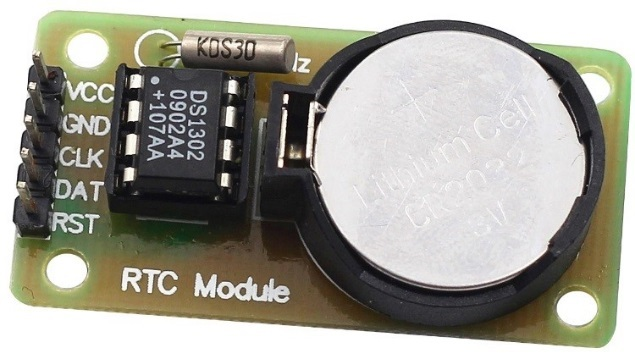
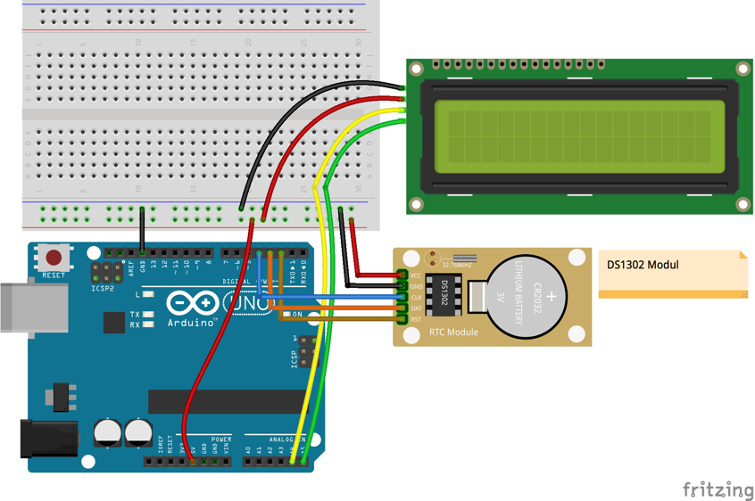

# Lekce 23: Hodiny reálného času

## Úvod

Existuje mnoho populárních modulů hodin reálného času, jako je DS1302, DS1307, PCF8485 atd. Jsou široce používány vzhledem k jejich jednoduchému “interfejsu“, nízké ceně a snadnosti použití. V této lekci budeme používat DS1302 modul hodin reálného času.

## Komponenty

- Arduino
- USB kabel
- DS1302 Hodiny reálného času
- LCD displej
- Breadboard vodiče
- Breadboard

<p align="center"></p>

## Princip

Obvod udržovacích hodin DS1302 obsahuje hodiny reálného času, kalendář a 31B statickou paměť RAM. Zařízení komunikuje s mikroprocesorem přes jednoduché sériové rozhraní. Hodiny reálného času poskytují sekundy, minuty, hodiny, den v týdnu, den v měsíci, měsíc a rok. Konec měsíce je automaticky přizpůsobován u měsíců s méně než 31 dny, včetně korekce u přestupného roku. Hodiny pracují v 24 hodinovém nebo 12 hodinovém režimu s indikátorem AM/PM.

Propojení DS1302 s mikroprocesorem je zjednodušeno užitím synchronního sériového přenosu. Pro komunikaci s hodinami/pamětí jsou použity pouze tři vodiče: CE, I/O (data) a SCLK (časovač). Data mohou být přenesena z/do hodin nebo paměti buď po jednom bajtu nebo až 31 bajtů v burst módu. DS1302 je navržen pro velmi malou spotřebu a udržení dat při příkonu menším, než 1μW.

## Postup experimentu

| I2C LCD1602 | Arduino |
|---|---|
| GND | GND |
| VCC | 5V |
| SDA | A4 (Mega: 20) |
| SCL | A5 (Mega: 21) |

**Krok 1:** Vytvoř obvod

Zapojení mezi I2C LCD1602, DS1302 a Arduino je znázorněno níže:

| DS1302 | Arduino |
|---|---|
| VCC | 5V |
| GND | GND |
| CLK | 4 |
| DAT | 3 |
| RST | 2 |

<p align="center"></p>

**Krok 2:** Napiš kód do Arduino IDE

> **Poznámka:** Potřebuješ knihovny Rtc by Makuna a LiquidCrystal I2C – viz kapitola Instalace knihoven.

**Kód** – soubor `Hodiny_realneho_casu_DS1302.ino`:

<!-- kod: Hodiny_realneho_casu_DS1302/Hodiny_realneho_casu_DS1302.ino -->
```cpp
/*
 * LaskaKit Arduino MAXI Starter kit – Lekce 23: Hodiny reálného času DS1302
 *
 * Na displeji I2C LCD1602 se zobrazuje čas, den v týdnu a datum
 * z modulu DS1302. Při prvním spuštění (nebo když jsou hodiny
 * nastavené na starší čas) se nastaví čas, kdy byl program přeložen.
 * Díky záložní baterii na modulu hodiny běží i po odpojení napájení.
 *
 * Zapojení:
 *   DS1302: VCC–5V, GND–GND, CLK–4, DAT–3, RST–2
 *   I2C LCD1602: GND–GND, VCC–5V, SDA/SCL podle lekce 6
 *
 * Knihovny: Rtc by Makuna, LiquidCrystal I2C (Frank de Brabander) – Správce knihoven
 * Desky:    Arduino UNO R3, Arduino UNO R4 WiFi, Arduino Mega 2560
 *
 * Verze návodu 3.0 (10/2026)
 * LaskaKit | https://www.laskakit.cz | podpora@laskakit.cz
 */

#include <Wire.h>
#include <LiquidCrystal_I2C.h>
#include <ThreeWire.h>
#include <RtcDS1302.h>

// DS1302: DAT (IO) = 3, CLK = 4, RST (CE) = 2
ThreeWire rtcVodice(3, 4, 2);
RtcDS1302<ThreeWire> rtc(rtcVodice);

LiquidCrystal_I2C lcd(0x27, 16, 2);

const char *dnyTydne[7] = {"NE", "PO", "UT", "ST", "CT", "PA", "SO"};

void setup() {
  Serial.begin(9600);
  lcd.init();
  lcd.backlight();
  lcd.print("DS1302 start...");

  rtc.Begin();

  // čas překladu programu = výchozí čas
  RtcDateTime casPrekladu = RtcDateTime(__DATE__, __TIME__);

  if (rtc.GetIsWriteProtected()) {
    rtc.SetIsWriteProtected(false);  // povolit zápis
  }
  if (!rtc.IsDateTimeValid()) {
    rtc.SetDateTime(casPrekladu);    // hodiny nemají platný čas
  }
  if (!rtc.GetIsRunning()) {
    rtc.SetIsRunning(true);          // spustit zastavené hodiny
  }
  if (rtc.GetDateTime() < casPrekladu) {
    rtc.SetDateTime(casPrekladu);    // hodiny jdou pozadu -> opravit
  }

  delay(1000);
  lcd.clear();
}

void loop() {
  RtcDateTime ted = rtc.GetDateTime();

  if (!ted.IsValid()) {
    lcd.setCursor(0, 0);
    lcd.print("CHYBA RTC!      ");
    lcd.setCursor(0, 1);
    lcd.print("Zkontroluj modul");
    delay(1000);
    return;
  }

  // 1. řádek: HH:MM:SS  DEN
  lcd.setCursor(0, 0);
  vypisDveCislice(ted.Hour());
  lcd.print(":");
  vypisDveCislice(ted.Minute());
  lcd.print(":");
  vypisDveCislice(ted.Second());
  lcd.print("   ");
  lcd.print(dnyTydne[ted.DayOfWeek()]);

  // 2. řádek: DD.MM.RRRR
  lcd.setCursor(0, 1);
  vypisDveCislice(ted.Day());
  lcd.print(".");
  vypisDveCislice(ted.Month());
  lcd.print(".");
  lcd.print(ted.Year());

  // totéž do sériového monitoru
  char text[24];
  snprintf(text, sizeof(text), "%02u.%02u.%04u %02u:%02u:%02u",
           ted.Day(), ted.Month(), ted.Year(),
           ted.Hour(), ted.Minute(), ted.Second());
  Serial.println(text);

  delay(1000);
}

void vypisDveCislice(int cislo) {
  if (cislo < 10) lcd.print("0");  // doplnit nulu: 7 -> 07
  lcd.print(cislo);
}
```
<!-- /kod -->

**Krok 3:** Zkompiluj kód

**Krok 4:** Nahraj sketch do Arduina

Nyní uvidíš na LCD displeji čas, den v týdnu a datum.

Při prvním nahrání se do hodin uloží čas, kdy byl program přeložen. Modul má záložní baterii, takže čas si pamatuje i po odpojení napájení.
