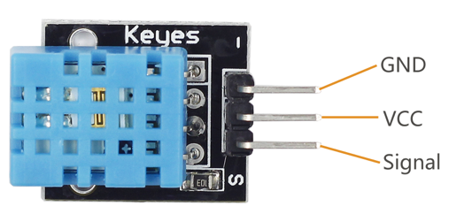

# Lekce 24: Senzor teploty a vlhkosti vzduchu DHT11

## Úvod

Digitální čidlo teploty a vlhkosti DHT11 je kompozitní senzor, který obsahuje kalibrovaný digitální výstup. Snímač obsahuje rezistivní čidlo vlhkosti a NTC teplotní senzor, a je spojen s vysoce výkonným 8-bitovým převodnikem.

## Komponenty

- Arduino
- USB kabel
- Teplotní modul DHT11
- LCD displej
- Breadboard vodiče

<p align="center"></p>

<p align="center"></p>

## Princip

Pouze tři piny jsou k dispozici pro použití: VCC, GND, a DATA. Komunikační proces začíná posláním startového signálu do DHT11. Pak DHT11 přijímá signál a vrací odpověď. Poté hostitel přijme odpověď a začne přijímat 40bitová data (8-bitové integer vlhkost + 8-bitové decimal vlhkost + 8-bitové integer teplota + 8-bitové decimal teplota + 8 bitů checksum).

## Postup experimentu

| I2C LCD1602 | Arduino |
|---|---|
| GND | GND |
| VCC | 5V |
| SDA | A4 (Mega: 20) |
| SCL | A5 (Mega: 21) |

**Krok 1:** Vytvoř obvod

| DHT11 modul | Arduino |
|---|---|
| “-” | GND |
| + | 5V |
| S | 4 |

<p align="center"></p>

**Krok 2:** Napiš kód do Arduino IDE

> **Poznámka:** Potřebuješ knihovny DHT sensor library (Adafruit) a LiquidCrystal I2C – viz kapitola Instalace knihoven.

**Kód** – soubor `Senzor_teploty_a_vlhkosti_DHT11.ino`:

<!-- kod: Senzor_teploty_a_vlhkosti_DHT11/Senzor_teploty_a_vlhkosti_DHT11.ino -->
```cpp
/*
 * LaskaKit Arduino MAXI Starter kit – Lekce 24: Senzor teploty a vlhkosti vzduchu DHT11
 *
 * Čidlo DHT11 měří teplotu a relativní vlhkost vzduchu.
 * Hodnoty se zobrazují na displeji I2C LCD1602 a v sériovém monitoru.
 * DHT11 je pomalé čidlo – nová hodnota je k dispozici zhruba každé 2 s.
 *
 * Zapojení:
 *   DHT11 modul: – na GND, + na 5V, S na pin 4
 *   I2C LCD1602: GND–GND, VCC–5V, SDA/SCL podle lekce 6
 *
 * Knihovny: DHT sensor library (Adafruit) + Adafruit Unified Sensor, LiquidCrystal I2C – Správce knihoven
 * Desky:    Arduino UNO R3, Arduino UNO R4 WiFi, Arduino Mega 2560
 *
 * Verze návodu 3.0 (10/2026)
 * LaskaKit | https://www.laskakit.cz | podpora@laskakit.cz
 */

#include <Wire.h>
#include <LiquidCrystal_I2C.h>
#include <DHT.h>

const int dhtPin = 4;
DHT dht(dhtPin, DHT11);
LiquidCrystal_I2C lcd(0x27, 16, 2);

void setup() {
  Serial.begin(9600);
  dht.begin();
  lcd.init();
  lcd.backlight();
  lcd.print("DHT11 start...");
  delay(2000);  // čidlo potřebuje chvíli po zapnutí
  lcd.clear();
}

void loop() {
  float vlhkost = dht.readHumidity();
  float teplota = dht.readTemperature();  // ve °C

  if (isnan(vlhkost) || isnan(teplota)) {
    // čtení se nepovedlo – nejčastěji špatně zapojený pin S
    lcd.setCursor(0, 0);
    lcd.print("Chyba cteni DHT ");
    lcd.setCursor(0, 1);
    lcd.print("Zkontroluj pin 4");
    Serial.println("Chyba cteni z DHT11");
  } else {
    lcd.setCursor(0, 0);
    lcd.print("Teplota: ");
    lcd.print(teplota, 1);
    lcd.print((char)223);
    lcd.print("C ");
    lcd.setCursor(0, 1);
    lcd.print("Vlhkost: ");
    lcd.print(vlhkost, 0);
    lcd.print(" %   ");

    Serial.print("Teplota: ");
    Serial.print(teplota, 1);
    Serial.print(" C, vlhkost: ");
    Serial.print(vlhkost, 0);
    Serial.println(" %");
  }
  delay(2000);
}
```
<!-- /kod -->

**Krok 3:** Zkompiluj kód

**Krok 4:** Nahraj sketch do Arduina

Teď uvidíš aktuální vlhkost a teplotu na displeji.
