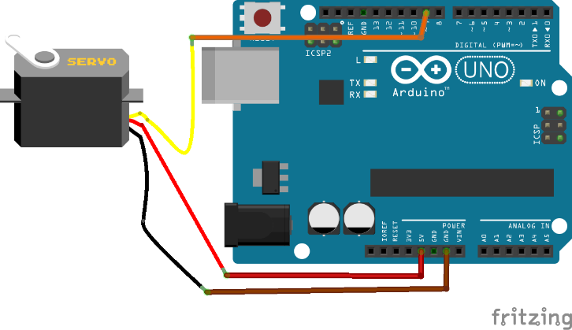
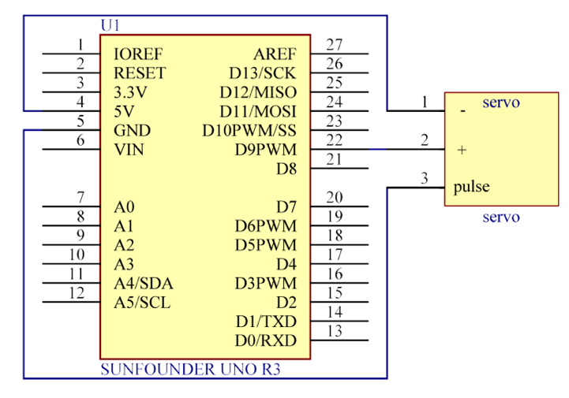

# Lekce 27: Servo

## Úvod

Servomotor (Servo) je typ motoru s převodovkou, který se může otáčet jen o 180 stupňů (některý víc) a je řízen impulsy z Arduino. Tyto impulsy „řeknou“ servu, do jaké pozice se má otočit.

Servo má tři vodiče. Hnědý vodič je GND, červený vodič je VCC a oranžový vodič je signál.

## Komponenty

- Arduino
- USB kabel
- Servomotor
- Breadboard vodiče

<p align="center"></p>

## Princip

Servo se skládá z pláště, obvodové desky, non-jádra motoru, převodovky a detekce polohy. Jeho pracovní princip je následující: Arduino vysílá signál PWM do serva. Tam je tento signál zpracováván IO pro výpočet směru otáčení k řízení motoru, a pak je tato hnací síla přenášena na otočné rameno pomocí ozubeného převodu. Ve stejné době vrací detektor signál pozici, jestli je dosaženo nastavení polohy nebo ne.

## Postup experimentu

**Krok 1:** Vytvoř obvod

<p align="center"> </p>

**Krok 2:** Napiš kód do Arduino IDE

**Kód** – soubor `Servo.ino`:

<!-- kod: Servo/Servo.ino -->
```cpp
/*
 * LaskaKit Arduino MAXI Starter kit – Lekce 27: Servo
 *
 * Servo se pomalu otáčí z 0° do 180° a zpět.
 *
 * Zapojení:
 *   Servo: hnědý vodič na GND, červený na 5V, oranžový (signál) na pin 9
 *
 * Knihovny: Servo (součást Arduino IDE)
 * Desky:    Arduino UNO R3, Arduino UNO R4 WiFi, Arduino Mega 2560
 *
 * Verze návodu 3.0 (10/2026)
 * LaskaKit | https://www.laskakit.cz | podpora@laskakit.cz
 */

#include <Servo.h>

Servo servo;
const int servoPin = 9;

void setup() {
  servo.attach(servoPin);
}

void loop() {
  for (int uhel = 0; uhel <= 180; uhel++) {  // tam
    servo.write(uhel);
    delay(15);  // počkat, než servo dojede
  }
  for (int uhel = 180; uhel >= 0; uhel--) {  // a zpět
    servo.write(uhel);
    delay(15);
  }
}
```
<!-- /kod -->

**Krok 3:** Zkompiluj kód

**Krok 4:** Nahraj sketch do Arduina

Nyní uvidíš, jak se servo plynule otáčí z 0° do 180° a zpět.
