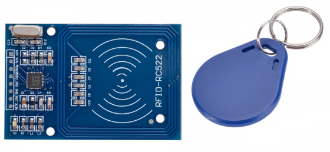

# Lekce 30: RFID vstupní ochranný systém

## Úvod

RFID je zkratka pro radiofrekvenční identifikaci. Jedná se o bezdrátovou aplikaci pro přenos dat za účelem identifikace a sledování značek. V tomto experimentu budeme používat modul RFID, relé a I2C LCD1602 pro sestavení vstupního ochranného systému.

## Komponenty

- Arduino
- USB kabel
- RFID čtečka
- RFID čipový přívěsek na klíče
- RFID čipová karta
- 1-kanál relé modul
- I2C LCD1602
- Breadboard vodiče
- Breadboard

<p align="center"></p>

## Princip

Každá karta i přívěsek mají své jedinečné ID. Nejdřív ho zjistíme prvním programem (RFID\_zjisti\_ID) a zapíšeme do druhého programu (RFID\_pristupovy\_system) jako povolený klíč. Po přiložení povolené karty se na displeji ukáže její ID a pozdrav a relé na 2 s sepne – například elektrický zámek dveří. Neznámá karta relé nesepne a na displeji se objeví „Ahoj cizince!“.

> **Pozor:** Modul RFID napájej jen z pinu 3,3V, nikdy z 5V – jinak se zničí.

Modul RFID se dodává s nepřipájenou lištou pinů – před zapojením ji musíš připájet (případně nám to napiš do poznámky k objednávce). Modul pracuje s logikou 3,3 V a Arduino posílá signály o 5 V. Pro pokusy ve stavebnici to modul snese, pro trvalé zařízení ale použij převodník úrovní.

## Postup experimentu

**Krok 1:** Vytvoř obvod

| RFID RC522 | UNO R3 / UNO R4 WiFi (Mega) |
|---|---|
| VCC | 3,3V |
| RST | 9 |
| GND | GND |
| MISO | 12 (Mega: 50) |
| MOSI | 11 (Mega: 51) |
| SCK | 13 (Mega: 52) |
| SDA | 10 |
| IRQ | nezapojuj |

Displej I2C LCD1602 zapoj stejně jako v lekci 6.

Modul relé zapoj stejně jako v lekci 25 (signál S na pin 8).

**Krok 2:** Napiš kód do Arduino IDE

> **Poznámka:** Potřebuješ knihovny MFRC522 a LiquidCrystal I2C – viz kapitola Instalace knihoven.

**Kód RFID_zjisti_ID** – soubor `RFID_zjisti_ID.ino`:

<!-- kod: RFID_zjisti_ID/RFID_zjisti_ID.ino -->
```cpp
/*
 * LaskaKit Arduino MAXI Starter kit – Lekce 30: RFID vstupní ochranný systém – zjištění ID karty
 *
 * 1. část lekce: přilož kartu nebo přívěsek ke čtečce a v sériovém
 * monitoru (9600 Bd) uvidíš jeho ID. ID si opiš – v programu
 * RFID_pristupovy_system ho pak zadáš jako povolený klíč.
 *
 * Zapojení:
 *   RFID RC522: 3.3V–3,3V (NE 5V!), GND–GND, RST–9, SDA (SS)–10, IRQ nezapojuj
 *   UNO R3 / UNO R4 WiFi: MOSI–11, MISO–12, SCK–13
 *   Mega 2560: MOSI–51, MISO–50, SCK–52
 *
 * Knihovny: MFRC522 (GithubCommunity) – Správce knihoven
 * Desky:    Arduino UNO R3, Arduino UNO R4 WiFi, Arduino Mega 2560
 *
 * Verze návodu 3.0 (10/2026)
 * LaskaKit | https://www.laskakit.cz | podpora@laskakit.cz
 */

#include <SPI.h>
#include <MFRC522.h>

const int ssPin = 10;   // SDA (SS)
const int rstPin = 9;   // RST
MFRC522 ctecka(ssPin, rstPin);

void setup() {
  Serial.begin(9600);
  SPI.begin();
  ctecka.PCD_Init();
  Serial.println("Priloz kartu nebo privesek ke ctecce...");
}

void loop() {
  // čekáme na novou kartu a přečteme její sériové číslo
  if (!ctecka.PICC_IsNewCardPresent() || !ctecka.PICC_ReadCardSerial()) {
    return;
  }

  Serial.print("Typ: ");
  Serial.println(ctecka.PICC_GetTypeName(ctecka.PICC_GetType(ctecka.uid.sak)));

  Serial.print("ID karty: ");
  for (byte i = 0; i < ctecka.uid.size; i++) {
    if (ctecka.uid.uidByte[i] < 0x10) Serial.print("0");
    Serial.print(ctecka.uid.uidByte[i], HEX);
    Serial.print(i < ctecka.uid.size - 1 ? " " : "");
  }
  Serial.println();

  Serial.print("Pro program pristupoveho systemu: {");
  for (byte i = 0; i < 4; i++) {
    Serial.print("0x");
    if (ctecka.uid.uidByte[i] < 0x10) Serial.print("0");
    Serial.print(ctecka.uid.uidByte[i], HEX);
    if (i < 3) Serial.print(", ");
  }
  Serial.println("}");
  Serial.println();

  ctecka.PICC_HaltA();  // uspat kartu, aby se nečetla pořád dokola
  delay(500);
}
```
<!-- /kod -->

**Kód RFID_pristupovy_system** – soubor `RFID_pristupovy_system.ino`:

<!-- kod: RFID_pristupovy_system/RFID_pristupovy_system.ino -->
```cpp
/*
 * LaskaKit Arduino MAXI Starter kit – Lekce 30: RFID vstupní ochranný systém
 *
 * 2. část lekce: po přiložení povolené karty se na displeji ukáže její
 * ID a pozdrav a na 2 s sepne relé (např. elektrický zámek).
 * Neznámá karta relé nesepne.
 * ID svých karet zjistíš programem RFID_zjisti_ID a zapíšeš je
 * do pole povoleneKarty níže.
 *
 * Zapojení:
 *   RFID RC522: 3.3V–3,3V (NE 5V!), GND–GND, RST–9, SDA (SS)–10, IRQ nezapojuj
 *   UNO R3 / UNO R4 WiFi: MOSI–11, MISO–12, SCK–13
 *   Mega 2560: MOSI–51, MISO–50, SCK–52
 *   Modul relé: S–8, +–5V, ––GND (viz lekce 25)
 *   I2C LCD1602: GND–GND, VCC–5V, SDA/SCL podle lekce 6
 *
 * Knihovny: MFRC522 (GithubCommunity), LiquidCrystal I2C – Správce knihoven
 * Desky:    Arduino UNO R3, Arduino UNO R4 WiFi, Arduino Mega 2560
 *
 * Verze návodu 3.0 (10/2026)
 * LaskaKit | https://www.laskakit.cz | podpora@laskakit.cz
 */

#include <SPI.h>
#include <MFRC522.h>
#include <Wire.h>
#include <LiquidCrystal_I2C.h>

const int ssPin = 10;
const int rstPin = 9;
const int relePin = 8;
const int RELE_ZAPNUTO = HIGH;  // u modulů spínaných nulou změň na LOW

MFRC522 ctecka(ssPin, rstPin);
LiquidCrystal_I2C lcd(0x27, 16, 2);

// Sem zapiš ID svých karet (4 bajty z programu RFID_zjisti_ID)
const int pocetKaret = 2;
const byte povoleneKarty[pocetKaret][4] = {
  {0xD0, 0xE7, 0xC2, 0x80},  // karta 1
  {0x4B, 0xE6, 0xD1, 0x3B}   // karta 2 (přívěsek)
};
const char *pozdravy[pocetKaret] = {
  "Zdravim bastlire",
  "  Ahoj Kosto!   "
};

void setup() {
  Serial.begin(9600);
  SPI.begin();
  ctecka.PCD_Init();

  pinMode(relePin, OUTPUT);
  digitalWrite(relePin, !RELE_ZAPNUTO);  // relé vypnuté

  lcd.init();
  lcd.backlight();
  zobrazVitej();
}

void loop() {
  if (!ctecka.PICC_IsNewCardPresent() || !ctecka.PICC_ReadCardSerial()) {
    return;
  }

  // 1. řádek: ID karty
  lcd.clear();
  lcd.setCursor(0, 0);
  lcd.print("ID: ");
  for (byte i = 0; i < 4; i++) {
    if (ctecka.uid.uidByte[i] < 0x10) lcd.print("0");
    lcd.print(ctecka.uid.uidByte[i], HEX);
  }

  // 2. řádek: pozdrav podle karty
  int karta = najdiKartu();
  lcd.setCursor(0, 1);
  if (karta >= 0) {
    lcd.print(pozdravy[karta]);
    digitalWrite(relePin, RELE_ZAPNUTO);   // otevřít
    delay(2000);
    digitalWrite(relePin, !RELE_ZAPNUTO);  // zavřít
  } else {
    lcd.print(" Ahoj cizince!  ");
    delay(2000);
  }

  ctecka.PICC_HaltA();
  zobrazVitej();
}

// vrátí pořadí povolené karty, nebo -1 pro neznámou kartu
int najdiKartu() {
  for (int k = 0; k < pocetKaret; k++) {
    bool shoda = true;
    for (byte i = 0; i < 4; i++) {
      if (ctecka.uid.uidByte[i] != povoleneKarty[k][i]) {
        shoda = false;
        break;
      }
    }
    if (shoda) return k;
  }
  return -1;
}

void zobrazVitej() {
  lcd.clear();
  lcd.setCursor(0, 0);
  lcd.print("     Vitej!     ");
  lcd.setCursor(0, 1);
  lcd.print(" Priloz kartu...");
}
```
<!-- /kod -->

**Krok 3:** Nahraj program RFID\_zjisti\_ID do Arduina

Otevři sériový monitor (9600 baud) a přilož kartu nebo přívěsek ke čtečce. Uvidíš typ karty, její ID a řádek ve tvaru {0xD0, 0xE7, 0xC2, 0x80}, který rovnou zkopíruješ do programu.

**Krok 4:** Otevři program RFID\_pristupovy\_system a v poli povoleneKarty nahraď ukázková ID svými, například:

```cpp
{0xD0, 0xE7, 0xC2, 0x80},  // karta 1
```

**Krok 5:** Nahraj program RFID\_pristupovy\_system do Arduina

Teď přilož kartu ke čtečce. Pokud je povolená, LCD zobrazí její ID a pozdrav, například „ID: D0E7C280“ a „Zdravim bastlire“, a na 2 sekundy sepne relé. Pokud karta povolená není, LCD zobrazí „Ahoj cizince!“. Pak se znovu objeví „Vitej!“.
