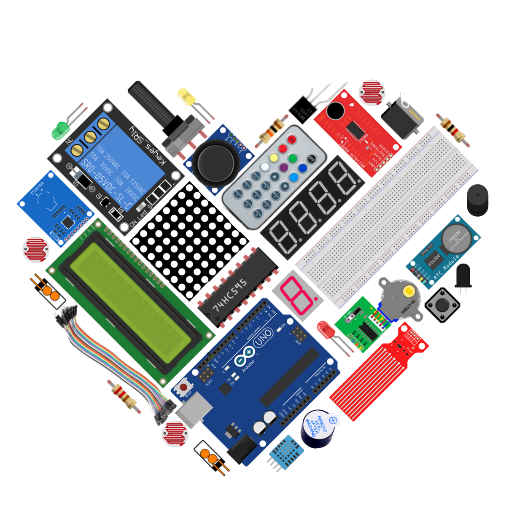

# LaskaKit Arduino MAXI Starter kit – návod

Verze 3.0 (říjen 2026). Návod a programy ke stavebnici [LaskaKit Arduino MAXI Starter kit](https://www.laskakit.cz/laskkit-arduino-maxi-starter-kit--rfid/) – 31 lekcí od blikání LED až po RFID zámek.

Pro Arduino UNO R3, UNO R4 WiFi a Mega 2560.

## Obsah

- [Arduino – začínáme!](00-zaciname/README.md)
- [Instalace knihoven](01-instalace-knihoven/README.md)
- [Značení rezistorů](02-znaceni-rezistoru/README.md)
- [Když něco nefunguje](03-kdyz-neco-nefunguje/README.md)
- [Lekce 1: Řízení LED tlačítkem](lekce-01-rizeni-led-tlacitkem/README.md)
- [Lekce 2: Řízení LED PWMkou](lekce-02-rizeni-led-pwmkou/README.md)
- [Lekce 3: LED tekoucí potok](lekce-03-led-tekouci-potok/README.md)
- [Lekce 4: Interaktivní tekoucí LED světla](lekce-04-interaktivni-tekouci-led-svetla/README.md)
- [Lekce 5: Používání skeneru sběrnice I²C](lekce-05-pouzivani-skeneru-sbernice-i2c/README.md)
- [Lekce 6: I²C LCD displej](lekce-06-i2c-lcd-displej/README.md)
- [Lekce 7: Bzučák](lekce-07-bzucak/README.md)
- [Lekce 8: Otřesové čidlo](lekce-08-otresove-cidlo/README.md)
- [Lekce 9: Kvízový bzučák](lekce-09-kvizovy-bzucak/README.md)
- [Lekce 10: Sériový monitor](lekce-10-seriovy-monitor/README.md)
- [Lekce 11: Fotorezistor](lekce-11-fotorezistor/README.md)
- [Lekce 12: Ovládání zvuku pomocí světla](lekce-12-ovladani-zvuku-pomoci-svetla/README.md)
- [Lekce 13: Senzor plamene](lekce-13-senzor-plamene/README.md)
- [Lekce 14: Voltmetr](lekce-14-voltmetr/README.md)
- [Lekce 15: Zvukový senzor](lekce-15-zvukovy-senzor/README.md)
- [Lekce 16: Senzor hladiny vody](lekce-16-senzor-hladiny-vody/README.md)
- [Lekce 17: Teplotní čidlo LM-35](lekce-17-teplotni-cidlo-lm-35/README.md)
- [Lekce 18: Sedmisegmentový displej](lekce-18-sedmisegmentovy-displej/README.md)
- [Lekce 19: Stopky – 4místný sedmisegmentový displej](lekce-19-stopky-4mistny-sedmisegmentovy-displej/README.md)
- [Lekce 20: 8×8 LED matice](lekce-20-8x8-led-matice/README.md)
- [Lekce 21: RGB LED](lekce-21-rgb-led/README.md)
- [Lekce 22: Řízení sedmisegmentového displeje s 74HC595](lekce-22-rizeni-sedmisegmentoveho-displeje-s-74hc595/README.md)
- [Lekce 23: Hodiny reálného času](lekce-23-hodiny-realneho-casu/README.md)
- [Lekce 24: Senzor teploty a vlhkosti vzduchu DHT11](lekce-24-senzor-teploty-a-vlhkosti-vzduchu-dht11/README.md)
- [Lekce 25: Modul relé](lekce-25-modul-rele/README.md)
- [Lekce 26: Krokový motor](lekce-26-krokovy-motor/README.md)
- [Lekce 27: Servo](lekce-27-servo/README.md)
- [Lekce 28: Joystick PS2](lekce-28-joystick-ps2/README.md)
- [Lekce 29: Infračervený přijímač](lekce-29-infracerveny-prijimac/README.md)
- [Lekce 30: RFID vstupní ochranný systém](lekce-30-rfid-vstupni-ochranny-system/README.md)
- [Lekce 31: Vstupní ochranný systém s heslem](lekce-31-vstupni-ochranny-system-s-heslem/README.md)

---

Verze 3.0, říjen 2026. Programy byly přepsány pro Arduino IDE 2 a ověřeny překladem pro Arduino UNO R3, Arduino UNO R4 WiFi a Arduino Mega 2560.

Za kontrolu a vyzkoušení návodu děkujeme Tomáši Spejchalovi.

LaskaKit – www.laskakit.cz – podpora@laskakit.cz
