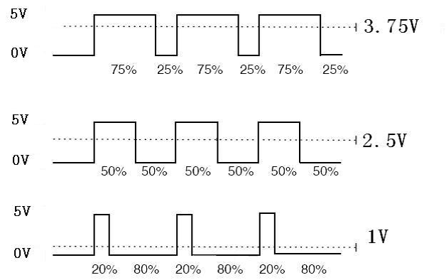
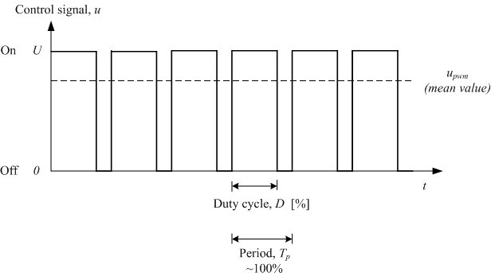
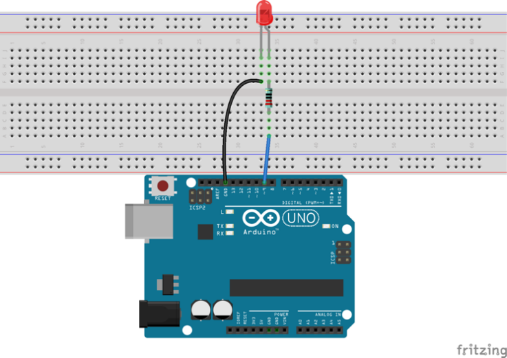
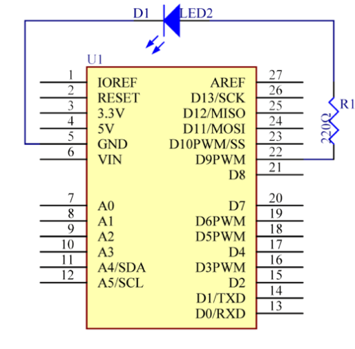

# Lekce 2: Řízení LED PWMkou

## Úvod

Nyní si ukážeme, jak z Arduina dostaneme signál jiný než "1" nebo "0". Postupně budeme měnit jas LEDky pomocí kódu. Vzhledem k tomu, že pulzující světlo vypadá jako dýchání, dali jsme mu odpovídající jméno – dýchající LEDka. Dosáhneme tohoto efektu pomocí pulzně šířkové modulace (PWM).

## Komponenty

- Arduino
- Breadboard
- Breadboard vodiče
- 1× LED
- Rezistor (220 Ω)
- USB kabel

<p align="center"></p>

## Princip

Pulzně šířková modulace neboli PWM (Pulse Width Modulation) je diskrétní modulace pro přenos analogového signálu pomocí signálu dvouhodnotového. Vzhledem ke svojí jednoduchosti (vyžaduje jen minimální množství komponentů pro implementaci) a efektivitě (minimální ztráty) je pulzně šířková modulace často využívána ve výkonové elektronice (sporáky, motory, osvětlení apod.), má ovšem své využití i v drobné elektronice, jako například u servomotorů.

<p align="center"></p>

Přenosový signál, který nese informaci o přenášené hodnotě, může nabývat hodnot zapnuto/vypnuto tj. log. 1 / log. 0 (v našem případě 5 V a 0 V). Hodnota přenášeného signálu je v přenosu "zakódována" jako poměr mezi stavy zapnuto/vypnuto. Tomuto poměru se říká střída. Cyklu, kdy dojde k přenosu jedné střídy, se říká perioda. Omezením pro PWM je to, že přenos informace je vždy omezen na relativní vyjádření, a to 0–100 %. To znamená, že musí být znám poměr mezi skutečnou hodnotou a procentuálním vyjádřením. Časové hodnoty střídy se pohybují v sekundách nebo v milisekundách pro přesnější řízení. Perioda je vždy součtem doby zapnuto a vypnuto.

Periodu je potřeba opakovat dostatečně rychle, aby nebylo vidět, že LEDka bliká, a vypadalo to, že svítí trvale.

Z oscilogramu je patrné, že amplituda napětí výstupu je 5 V. Skutečné (průměrné) výstupní napětí je díky PWM pouze 3,75 V, protože 5 V trvá jen 75 % periody (střída, neboli *duty cycle*, je 75 %).

Tři základní parametry PWM:

- Střída (duty cycle) je poměr mezi stavy zapnuto/vypnuto.
- Perioda je součtem doby zapnuto a vypnuto.
- Amplituda napětí je zde 0–5 V.

## Postup experimentu

**Krok 1:** Vytvoř obvod

<p align="center"> </p>

**Krok 2:** Napiš kód do Arduino IDE

**Kód** – soubor `Rizeni_LED_PWM.ino`:

<!-- kod: Rizeni_LED_PWM/Rizeni_LED_PWM.ino -->
```cpp
/*
 * LaskaKit Arduino MAXI Starter kit – Lekce 2: Řízení LED pomocí PWM
 *
 * „Dýchající“ LED – plynule se rozsvěcí a zase zhasíná.
 * Jas se řídí pulzně šířkovou modulací (PWM) funkcí analogWrite().
 *
 * Zapojení:
 *   LED (anoda, delší nožička) přes rezistor 220 Ω na pin 9
 *   LED (katoda, kratší nožička) na GND
 *
 * Knihovny: žádné (jen Arduino IDE)
 * Desky:    Arduino UNO R3, Arduino UNO R4 WiFi, Arduino Mega 2560
 *
 * Verze návodu 3.0 (10/2026)
 * LaskaKit | https://www.laskakit.cz | podpora@laskakit.cz
 */

const int ledPin = 9;  // pin s podporou PWM (na desce označený ~)

void setup() {
  pinMode(ledPin, OUTPUT);
}

void loop() {
  // Rozsvěcování: jas od 0 do 255
  for (int jas = 0; jas <= 255; jas++) {
    analogWrite(ledPin, jas);
    delay(8);
  }
  // Zhasínání: jas od 255 do 0
  for (int jas = 255; jas >= 0; jas--) {
    analogWrite(ledPin, jas);
    delay(8);
  }
  delay(800);  // krátká pauza mezi „nádechy“
}
```
<!-- /kod -->

**Krok 3:** Připoj desku k počítači

**Krok 4:** Vyber desku a port

**Krok 5:** Zkompiluj a nahraj sketch do Arduina (Ctrl+U)

Teď uvidíš, jak LEDka postupně zjasňuje a zase tmavne, a tak pořád dokola.
