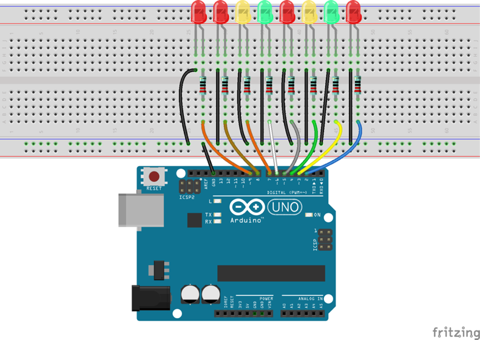
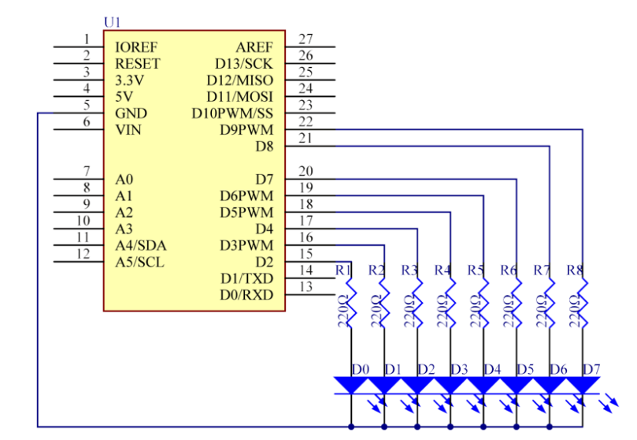

# Lekce 3: LED Tekoucí potok

## Úvod

V této lekci uděláme jednoduchý, ale zajímavý projekt – pomocí LED vytvoříme tekoucí LED světla. Tato plynulá světla jsou tvořena osmi LED v řadě, která se postupně rozsvítí a tmavnou jeden po druhém, stejně jako tekoucí voda.

## Komponenty

- Arduino
- Breadboard
- Breadboard vodiče
- 8x LED
- 8x Rezistor (220Ω)
- USB kabel
## Princip

Princip tohoto projektu je jednoduchý – zapnout osm LED za sebou.

## Postup projektu

**Krok 1:** Vytvoř obvod

<p align="center"> </p>

**Krok 2:** Napiš kód do Arduino IDE

**Kód** – soubor `LED_Tekouci_potok.ino`:

<!-- kod: LED_Tekouci_potok/LED_Tekouci_potok.ino -->
```cpp
/*
 * LaskaKit Arduino MAXI Starter kit – Lekce 3: LED tekoucí potok
 *
 * Osm LED se postupně rozsvěcí a zhasíná jedna po druhé,
 * jako by světlem tekla voda – tam a zpátky.
 *
 * Zapojení:
 *   8× LED přes rezistor 220 Ω na piny 2, 3, 4, 5, 6, 7, 8, 9
 *   Katody (kratší nožičky) všech LED na GND
 *
 * Knihovny: žádné (jen Arduino IDE)
 * Desky:    Arduino UNO R3, Arduino UNO R4 WiFi, Arduino Mega 2560
 *
 * Verze návodu 3.0 (10/2026)
 * LaskaKit | https://www.laskakit.cz | podpora@laskakit.cz
 */

const int prvniPin = 2;     // pin první LED
const int posledniPin = 9;  // pin poslední LED
const int pauza = 100;      // rychlost efektu v ms

void setup() {
  for (int pin = prvniPin; pin <= posledniPin; pin++) {
    pinMode(pin, OUTPUT);
  }
}

void loop() {
  // rozsvítit zleva doprava
  for (int pin = prvniPin; pin <= posledniPin; pin++) {
    digitalWrite(pin, HIGH);
    delay(pauza);
  }
  // zhasnout zprava doleva
  for (int pin = posledniPin; pin >= prvniPin; pin--) {
    digitalWrite(pin, LOW);
    delay(pauza);
  }
  // rozsvítit zprava doleva
  for (int pin = posledniPin; pin >= prvniPin; pin--) {
    digitalWrite(pin, HIGH);
    delay(pauza);
  }
  // zhasnout zleva doprava
  for (int pin = prvniPin; pin <= posledniPin; pin++) {
    digitalWrite(pin, LOW);
    delay(pauza);
  }
}
```
<!-- /kod -->

**Krok 3:** Připoj desku k počítači

**Krok 4:** Vyber desku a port

**Krok 5:** Zkompiluj a nahraj sketch do Arduina (Ctrl+U)

Nyní bys měl vidět osm LED světel, která se rozzáří jedno po druhém - zleva doprava, a potom ztlumeně postupně - zprava doleva. A zase opačně. Celý tento proces se bude opakovat, dokud bude obvod napájen.
