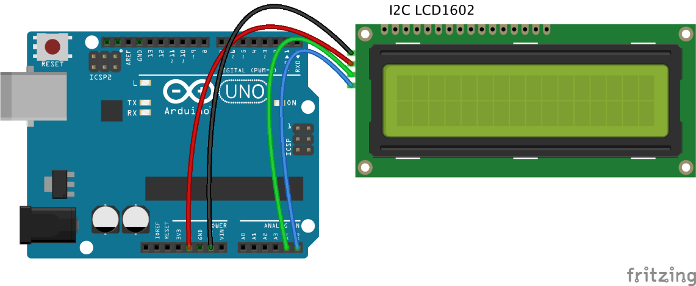
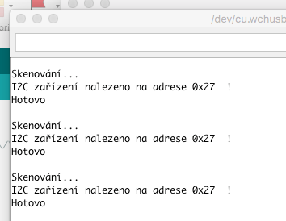

# Lekce 5: Používání skeneru sběrnice I²C

## Úvod

Dozvěděli jsme se od našeho zákazníka, že existují převodníky, které mají jinou I2C adresu, než popisujeme v další lekci (prý dostal převodník s adresou 0x3F, což se samozřejmě může stát). Tak jsme se rozhodli přidat tuhle lekci a naučit Tě skenovat adresy na sběrnici I2C.

## Komponenty

- Arduino
- USB kabel
- I²C zařízení (I2C LCD displej nebo Hodiny reálného času)
- Breadboard vodiče
## Princip

Každé zařízení s I2C sběrnicí má adresu I2C, kterou používá k přijímání příkazů nebo odesílání zpráv. Bohužel je to jedna z oblastí, kde dokumentace často chybí. Tak se pojďme podívat a najít adresu na příkladu I2C převodníku pro LCD displej.

Tento velmi jednoduchý sketch skenuje sběrnici I2C pro zařízení. Pokud je zařízení nalezeno, je hlášeno v sériovém monitoru Arduino.

Sketch zobrazuje 7-bitové adresy nalezených zařízení jako hexadecimální hodnoty. Tato hodnota může být použita pro funkci "Wire.begin", která používá 7-bitovou adresu. Každé nalezené zařízení na sběrnici I2C je hlášeno. Zapojovat a odpojovat I2C zařízení můžeš za běhu aplikace.

## Postup experimentu

**Krok 1:** Vytvoř obvod

Spojení mezi I2C LCD1602 a Arduino:

| I2C LCD1602 | UNO R3 / UNO R4 WiFi | Arduino Mega |
|---|---|---|
| GND | GND | GND |
| VCC | 5V | 5V |
| SDA | A4 | 20 |
| SCL | A5 | 21 |

<p align="center"></p>

**Krok 2:** Napiš kód do Arduino IDE

**Kód** – soubor `I2C_skener.ino`:

<!-- kod: I2C_skener/I2C_skener.ino -->
```cpp
/*
 * LaskaKit Arduino MAXI Starter kit – Lekce 5: Skener sběrnice I²C
 *
 * Projde všechny adresy na sběrnici I²C a vypíše do sériového
 * monitoru ty, na kterých odpovědělo nějaké zařízení.
 * Hodí se, když LCD displej nic neukazuje – zjistíš jeho skutečnou
 * adresu (obvykle 0x27, někdy 0x3F).
 * Sériový monitor nastav na 9600 Bd.
 *
 * Zapojení:
 *   I2C LCD1602: GND–GND, VCC–5V
 *   UNO R3 / UNO R4 WiFi: SDA–A4, SCL–A5 (nebo piny SDA/SCL u AREF)
 *   Mega 2560: SDA–20, SCL–21
 *
 * Knihovny: žádné (jen Arduino IDE)
 * Desky:    Arduino UNO R3, Arduino UNO R4 WiFi, Arduino Mega 2560
 *
 * Verze návodu 3.0 (10/2026)
 * LaskaKit | https://www.laskakit.cz | podpora@laskakit.cz
 */

#include <Wire.h>

void setup() {
  Wire.begin();
  Serial.begin(9600);
  while (!Serial) { }  // u některých desek počkat na otevření monitoru
  Serial.println();
  Serial.println("I2C skener");
}

void loop() {
  int pocetZarizeni = 0;
  Serial.println("Skenuji...");

  for (byte adresa = 1; adresa < 127; adresa++) {
    // Zařízení, které na adrese existuje, potvrdí přenos (výsledek 0)
    Wire.beginTransmission(adresa);
    byte vysledek = Wire.endTransmission();

    if (vysledek == 0) {
      Serial.print("Nalezeno I2C zarizeni na adrese 0x");
      if (adresa < 16) Serial.print("0");
      Serial.println(adresa, HEX);
      pocetZarizeni++;
    } else if (vysledek == 4) {
      Serial.print("Neznama chyba na adrese 0x");
      if (adresa < 16) Serial.print("0");
      Serial.println(adresa, HEX);
    }
  }

  if (pocetZarizeni == 0) {
    Serial.println("Zadne I2C zarizeni nenalezeno. Zkontroluj zapojeni.");
  } else {
    Serial.println("Hotovo.");
  }
  Serial.println();
  delay(5000);  // další sken za 5 sekund
}
```
<!-- /kod -->

**Krok 3:** Připoj desku k počítači

**Krok 4:** Vyber desku a port

**Krok 5:** Zkompiluj a nahraj sketch do Arduina (Ctrl+U)

**Krok 6:** Otevři sériový monitor (ikona lupy vpravo nahoře) a nastav rychlost 9600 baud. 

Nyní uvidíš adresy všech nalezených zařízení na sběrnici I2C.

<p align="center"></p>
