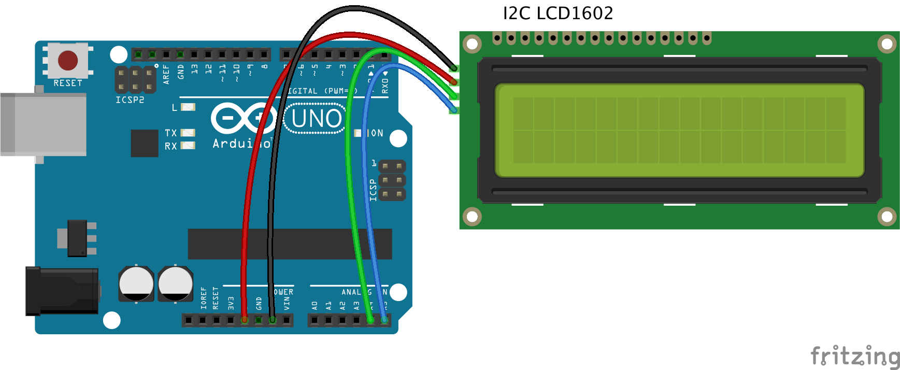

# Lekce 6: I²C LCD displej

## Úvod

Jak jistě všichni víme, LCD a další obrazovky výrazně obohacují naší interakci s přístroji, avšak mají i jednu nevýhodu. Pokud jsou připojeny ke kontroleru, bude obsazeno několik IO portů, kterých je omezený počet. A právě z těchto důvodů byl vyvinut převodník se I²C sběrnicí pro 1602 a 2004 LCD displej, který daný problém vyřešil.

Modrý potenciometr na převodníku se používá k nastavení podsvícení. 

## Co je to I²C?
I²C (anglicky Inter-Integrated Circuit, čteme anglicky I-squared-C nebo česky I-dva-C) je multi-masterová počítačová sériová sběrnice původně vyvinutá firmou Philips (dnes NXP Semiconductors), která je používána k připojování nízkorychlostních periferií k základním deskám, mikrokontrolérům, atp. Prakticky identická sběrnice se skrývá pod zkratkou TWI (Two Wire Interface - dvoudrátové rozhraní), kterou používá firma Atmel a další výrobci, namísto chráněné značky I²C. I²C používá pouze dva obousměrné kanály - datový kanál SDA a hodinový signál SCL s pull-up rezistory. Typicky se používá napětí +5 V nebo +3,3 V, povoleny jsou však i systémy s jiným napětím.

<p align="center"></p>

## Komponenty

- Arduino
- LCD displej
- USB kabel
- Kabely Dupont samec-samice

## Princip

V tomto pokusu necháme I²C LCD1602 displej zobrazit “Laskarduino” a “Zdravim bastlire!" pomocí programování.

## Postup experimentu

**Krok 1:** Vytvoř obvod

Spojení I²C mezi LCD1602 a Arduino:

| I²C LCD1602 | UNO R3 / UNO R4 WiFi | Arduino Mega |
|---|---|---|
| GND | GND | GND |
| VCC | 5V | 5V |
| SDA | A4 | 20 |
| SCL | A5 | 21 |

Poznámka: Vedení I²C LCD1602 bude stejné ve všech následujících lekcích.

Na desce UNO R4 WiFi i UNO R3 můžeš místo A4/A5 použít také piny SDA a SCL vedle pinu AREF – jsou propojené. Na Arduino Mega se displej připojuje na piny 20 (SDA) a 21 (SCL), případně SDA/SCL vedle AREF.

<p align="center"></p>

**Krok 2:** Napiš kód do Arduino IDE

**Kód** – soubor `I²C_LCD_displej.ino`:

<!-- kod: I²C_LCD_displej/I²C_LCD_displej.ino -->
```cpp
/*
 * LaskaKit Arduino MAXI Starter kit – Lekce 6: I²C LCD displej
 *
 * Na displeji postupně „přiběhnou“ zprava texty
 * „Laskarduino“ a „Zdravim bastlire!“.
 * Pokud displej nic neukazuje: otoč trimrem kontrastu na zadní straně
 * převodníku a ověř adresu skenerem z lekce 5.
 *
 * Zapojení:
 *   I²C LCD1602: GND–GND, VCC–5V
 *   UNO R3 / UNO R4 WiFi: SDA–A4, SCL–A5
 *   Mega 2560: SDA–20, SCL–21
 *
 * Knihovny: LiquidCrystal I²C (Frank de Brabander) – Správce knihoven
 * Desky:    Arduino UNO R3, Arduino UNO R4 WiFi, Arduino Mega 2560
 *
 * Verze návodu 3.0 (10/2026)
 * LaskaKit | https://www.laskakit.cz | podpora@laskakit.cz
 */

#include <Wire.h>
#include <LiquidCrystal_I²C.h>

// Adresa displeje 0x27, 16 znaků, 2 řádky.
// Pokud skener (lekce 5) ukázal jinou adresu, např. 0x3F, přepiš ji zde.
LiquidCrystal_I²C lcd(0x27, 16, 2);

const char text1[] = " Laskarduino              ";  // 26 znaků
const char text2[] = " Zdravim bastlire!        ";  // 26 znaků
const int delkaTextu = 26;
const int pauza = 500;  // rychlost posunu v ms

void setup() {
  lcd.init();       // inicializace displeje
  lcd.backlight();  // zapnout podsvícení
}

void loop() {
  bezText(text1, 0);  // první řádek
  bezText(text2, 1);  // druhý řádek
}

// Text „vjíždí“ zprava: znak vypíšeme a celý obsah posuneme doleva
void bezText(const char *text, int radek) {
  lcd.clear();
  lcd.setCursor(15, radek);
  for (int i = 0; i < delkaTextu; i++) {
    lcd.scrollDisplayLeft();
    lcd.print(text[i]);
    delay(pauza);
  }
}
```
<!-- /kod -->

**Krok 3:** Nainstaluj knihovnu LiquidCrystal I²C (autor Frank de Brabander) přes Správce knihoven – postup najdeš v kapitole Instalace knihoven na začátku návodu.

**Krok 4:** Připoj desku k počítači

**Krok 5:** Vyber desku a port

**Krok 6:** Zkompiluj a nahraj sketch do Arduina (Ctrl+U)

Nyní bys na svém displeji měl vidět „Laskarduino“ a „Zdravim bastlire!“.

**Pokud na displeji nic nevidíš, zkontroluj nastavení odporového trimru pro řízení kontrastu na převodníku. Může se stát, že je nastavený na minimum a tudíž na displeji není nic vidět.** Otáčením si nastav správný kontrsat, tak aby byl nápis na displeji co nejlépe čitelný.

<p align="center"></p>
