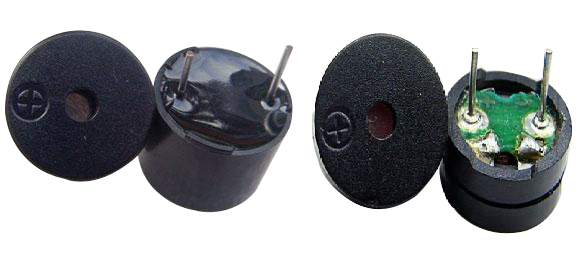
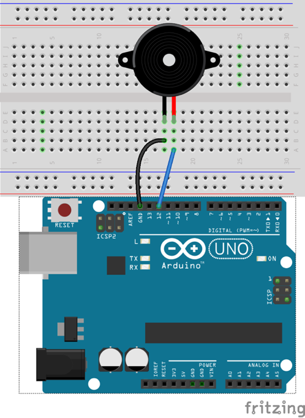
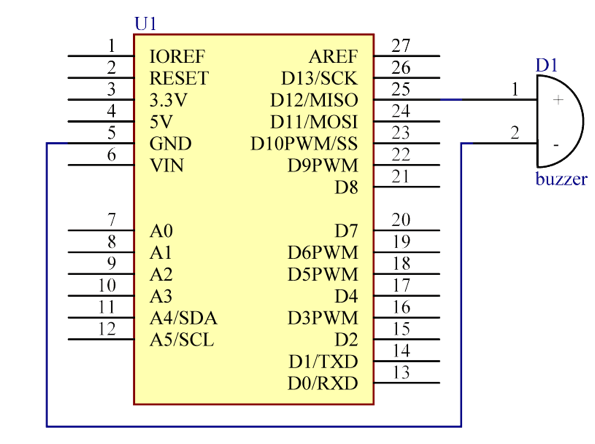

# Lekce 7: Bzučák

## Úvod

Bzučáky jsou velmi jednoduché výstupní prvky, které ti umožňují přidat do svého projektu zvukovou signalizaci. Často se s nimi setkáváš v běžném životě (například u mikrovlnky, tiskárny/kopírky, nebo dokonce u některých počítačových základových desek).

## Komponenty

- Arduino
- Breadboard
- USB kabel
- Aktivní bzučak
- Breadboard vodiče

## Princip

Bzučáky můžeme rozdělit na aktivní nebo pasivní (viz následující obrázek). Otoč kolíčky obou bzučáků lícem nahoru - ten se zelenou kulatou destičkou je pasivní, zatímco ten zalitý černým lepidlem (polymerem) je bzučák aktivní.

<p align="center"></p>

Rozdíl mezi aktivním a pasivním bzučákem:

Aktivní bzučák má v sobě zabudovaný oscilační zdroj, takže bude vydávat zvuky, pokud bude pod proudem. Pasivní bzučák ale takový zdroj nemá, proto při použití stejnosměrného napětí pípat nebude – místo toho je potřeba použít čtvercové vlny s frekvencí mezi 2K a 5K. Aktivní bzučák bývá často nákladnější a to právě z důvodu několika zabudovaných oscilátorů. V následujícím pokusu použijeme bzučák aktivní.

## Postup experimentu

**Krok 1:** Vytvoř obvod

Schéma zapojení

<p align="center"> </p>

**Krok 2:** Napiš kód do Arduino IDE

**Kód** – soubor `Aktivni_bzucak.ino`:

<!-- kod: Aktivni_bzucak/Aktivni_bzucak.ino -->
```cpp
/*
 * LaskaKit Arduino MAXI Starter kit – Lekce 7: Bzučák
 *
 * Aktivní bzučák má vlastní oscilátor – stačí na něj pustit napětí
 * a pípá. Program střídá krátká a dlouhá pípnutí.
 *
 * Zapojení:
 *   Aktivní bzučák: + (delší nožička) na pin 12, – na GND
 *
 * Knihovny: žádné (jen Arduino IDE)
 * Desky:    Arduino UNO R3, Arduino UNO R4 WiFi, Arduino Mega 2560
 *
 * Verze návodu 3.0 (10/2026)
 * LaskaKit | https://www.laskakit.cz | podpora@laskakit.cz
 */

const int bzucakPin = 12;

void setup() {
  pinMode(bzucakPin, OUTPUT);
}

void loop() {
  // tři krátká pípnutí
  for (int i = 0; i < 3; i++) {
    pipni(100);
    delay(100);
  }
  delay(400);
  // jedno dlouhé pípnutí
  pipni(600);
  delay(1000);
}

void pipni(int delka) {
  digitalWrite(bzucakPin, HIGH);  // bzučák zapnout
  delay(delka);
  digitalWrite(bzucakPin, LOW);   // bzučák vypnout
}
```
<!-- /kod -->

**Krok 3:** Zkompiluj kód

**Krok 4:** Nahraj sketch do Arduina

Nyní uslyšíš tři krátká a jedno dlouhé pípnutí, stále dokola.
