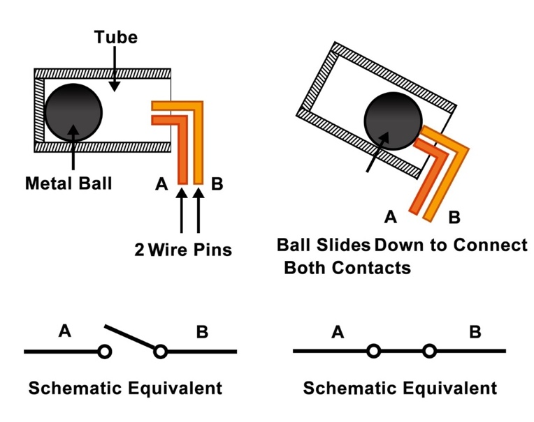
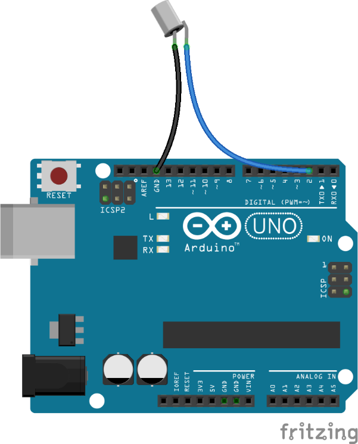
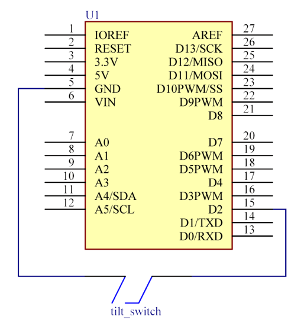

# Lekce 8: Otřesové čidlo

## Úvod

Otřesová čidla jsou velmi principiálně velmi jednoduchá – Je-li spínač nakloněn v určitém úhlu, kulička uvnitř sjede dolů a dotkne se dvou kontaktů připojených k vnějším kolíčkům. Tím propojí kontakty. Pokud zůstane kulička mimo kontakty, rozpojí je.

<p align="center"></p>

## Komponenty

- Arduino
- USB kabel
- Otřesové čidlo
- Breadboard vodiče

## Postup projektu

**Krok 1:** Vytvoř obvod

Schéma zapojení

<p align="center"> </p>

**Krok 2:** Napiš kód do Arduino IDE

**Kód** – soubor `Otresove_cidlo.ino`:

<!-- kod: Otresove_cidlo/Otresove_cidlo.ino -->
```cpp
/*
 * LaskaKit Arduino MAXI Starter kit – Lekce 8: Otřesové čidlo
 *
 * Když čidlem pohneš nebo ho nakloníš, kulička uvnitř spojí kontakty
 * a rozsvítí se LED na desce Arduino (pin 13).
 * Vstup používá vnitřní pull-up rezistor, žádný další rezistor není potřeba.
 *
 * Zapojení:
 *   Otřesové čidlo: jeden vývod na pin 2, druhý na GND
 *   LED: vestavěná LED „L“ na pinu 13
 *
 * Knihovny: žádné (jen Arduino IDE)
 * Desky:    Arduino UNO R3, Arduino UNO R4 WiFi, Arduino Mega 2560
 *
 * Verze návodu 3.0 (10/2026)
 * LaskaKit | https://www.laskakit.cz | podpora@laskakit.cz
 */

const int ledPin = 13;   // vestavěná LED
const int cidloPin = 2;  // otřesové čidlo

void setup() {
  pinMode(ledPin, OUTPUT);
  pinMode(cidloPin, INPUT_PULLUP);  // zapnout vnitřní pull-up rezistor
}

void loop() {
  // Sepnuté čidlo spojí pin 2 se zemí -> čteme LOW
  if (digitalRead(cidloPin) == LOW) {
    digitalWrite(ledPin, HIGH);
  } else {
    digitalWrite(ledPin, LOW);
  }
  delay(50);  // krátká pauza proti zákmitům kontaktů
}
```
<!-- /kod -->

**Krok 3:** Připoj desku k počítači

**Krok 4:** Vyber desku a port

**Krok 5:** Zkompiluj a nahraj sketch do Arduina (Ctrl+U)

Pohni čidlem a LED připojená k pinu 13 na Arduinu se rozsvítí. Čidlo je připojené na vstup s vnitřním pull-up rezistorem, takže žádný další rezistor nepotřebuješ.
