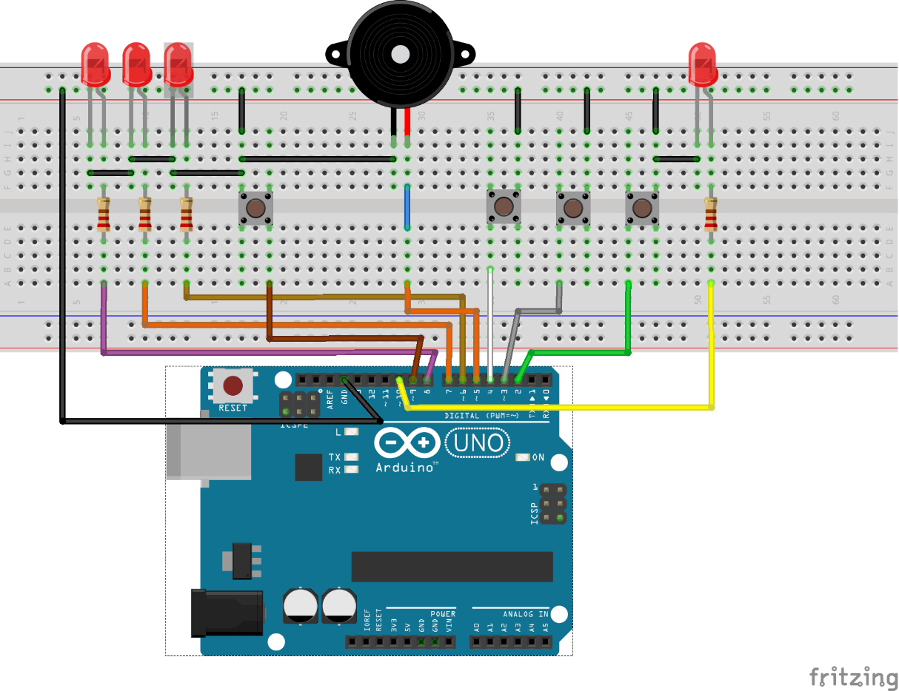
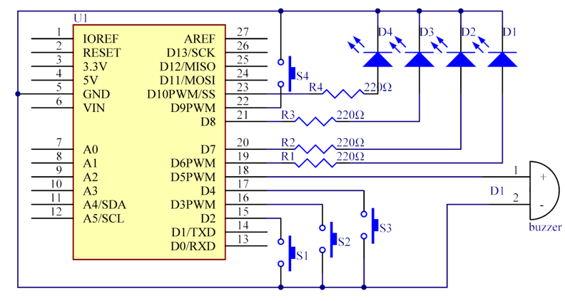
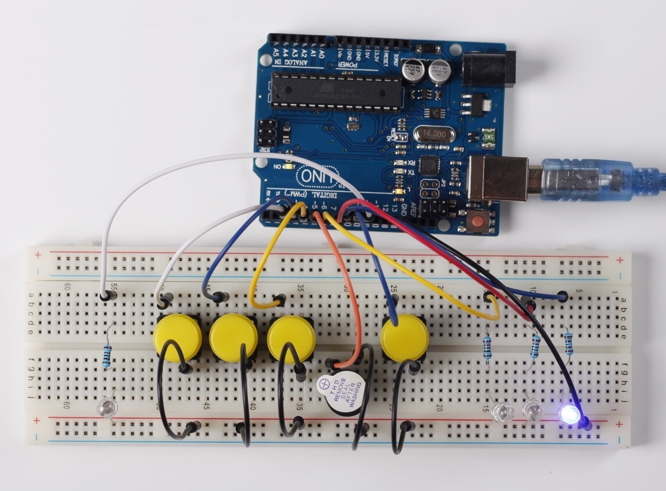

# Lekce 9: Kvízový bzučák

## Úvod

Ve vědomostních soutěžích, především těch zábavních (např. soutěže v odpovídání na otázky), organizátoři často používají bzučákový systém k přesnému a spravedlivému určení pořadí odpovídajících hráčů. Nyní je systém schopný objektivně ilustrovat přesnost a spravedlivost soutěže, čímž dělá pořad zábavnější. V této lekci budeme používat tlačítka, bzučáky a LED a vytvoříme kvízový bzučák.

## Komponenty

- Arduino
- USB kabel
- 4 Tlačítka
- 4x LED
- 4x Rezistor (220Ω)
- Aktivní bzučak
- Breadboard vodiče
- Breadboard
## Princip

Tlačítka 1, 2 a 3 slouží k odpovídání a tlačítkem 4 se resetuje. Pokud se nejprve zmáčke tlačítko 1, bzučák pípne, odpovídající LED se rozsvítí a všechny další LED zhasnou. Chceme-li začít další kolo, jednoduše zmáčkneme tlačítko 4.

## Postup experimentu

**Krok 1:** Vytvoř obvod

<p align="center"></p>

<p align="center"></p>

**Krok 2:** Napiš kód do Arduino IDE

**Kód** – soubor `Kvizovy_bzucak.ino`:

<!-- kod: Kvizovy_bzucak/Kvizovy_bzucak.ino -->
```cpp
/*
 * LaskaKit Arduino MAXI Starter kit – Lekce 9: Kvízový bzučák
 *
 * Tlačítkem 4 moderátor spustí kolo (rozsvítí se LED 4).
 * Kdo z hráčů 1–3 stiskne tlačítko první, toho LED se rozsvítí
 * a zazní bzučák. Ostatní tlačítka se ignorují, dokud moderátor
 * znovu nestiskne tlačítko 4.
 *
 * Zapojení:
 *   Tlačítka 1, 2, 3, 4: piny 2, 3, 4, 9 – druhý vývod tlačítek na GND
 *   LED 1, 2, 3, 4: přes rezistor 220 Ω na piny 6, 7, 8, 10, katody na GND
 *   Aktivní bzučák: + na pin 5, – na GND
 *
 * Knihovny: žádné (jen Arduino IDE)
 * Desky:    Arduino UNO R3, Arduino UNO R4 WiFi, Arduino Mega 2560
 *
 * Verze návodu 3.0 (10/2026)
 * LaskaKit | https://www.laskakit.cz | podpora@laskakit.cz
 */

const int tlacitka[] = {2, 3, 4};  // tlačítka hráčů 1–3
const int ledky[]    = {6, 7, 8};  // LED hráčů 1–3
const int tlacitkoModerator = 9;   // tlačítko 4
const int ledModerator = 10;       // LED 4
const int bzucakPin = 5;

bool koloBezi = false;

void setup() {
  for (int i = 0; i < 3; i++) {
    pinMode(tlacitka[i], INPUT_PULLUP);  // stisk = LOW
    pinMode(ledky[i], OUTPUT);
  }
  pinMode(tlacitkoModerator, INPUT_PULLUP);
  pinMode(ledModerator, OUTPUT);
  pinMode(bzucakPin, OUTPUT);
  zhasniVse();
}

void loop() {
  // Moderátor spouští nové kolo
  if (digitalRead(tlacitkoModerator) == LOW) {
    zhasniVse();
    digitalWrite(ledModerator, HIGH);
    koloBezi = true;
    delay(200);
  }

  if (koloBezi) {
    for (int i = 0; i < 3; i++) {
      if (digitalRead(tlacitka[i]) == LOW) {  // tento hráč byl první
        koloBezi = false;
        digitalWrite(ledModerator, LOW);
        digitalWrite(ledky[i], HIGH);
        pipni();
        break;
      }
    }
  }
}

void zhasniVse() {
  for (int i = 0; i < 3; i++) {
    digitalWrite(ledky[i], LOW);
  }
  digitalWrite(ledModerator, LOW);
}

void pipni() {
  digitalWrite(bzucakPin, HIGH);
  delay(600);
  digitalWrite(bzucakPin, LOW);
}
```
<!-- /kod -->

**Krok 3:** Připoj desku k počítači

**Krok 4:** Vyber desku a port

**Krok 5:** Zkompiluj a nahraj sketch do Arduina (Ctrl+U)

Nyní nejprve zmáčkni tlačítko 4. Pokud prvně zmáčkneš tlačítko 1, rozsvítí se odpovídající LED a pípne bzučák. Poté opět zmáčkni tlačítko 4 k resetování, než začneš s dalšími tlačítky.

<p align="center"></p>
