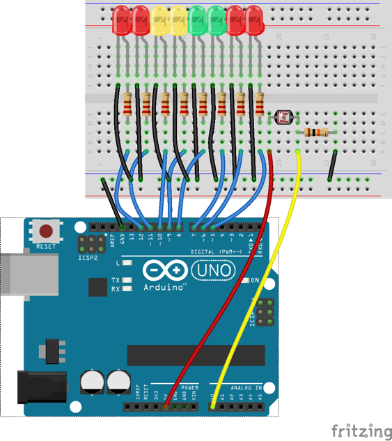
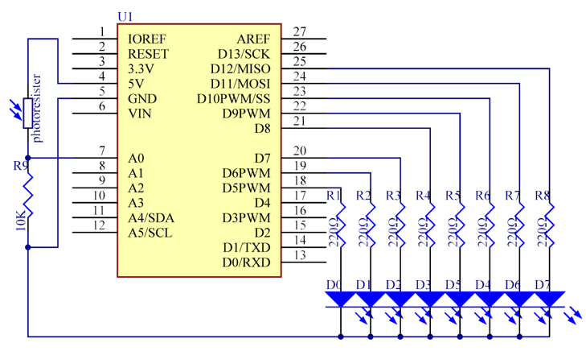

# Lekce 11: Fotorezistor

## Úvod

Fotorezistor (anglicky photoresistor/photocell) je světlem ovládaný proměnný rezistor. Odpor fotorezistoru se snižuje s rostoucí intenzitou dopadajícího světla; jinými slovy, je fotovodivý. Fotorezistor můžeme využít pro na světlo citlivé detektory, jež se aktivují světlem či tmou.

## Komponenty

- Arduino
- USB kabel
- Fotorezistor
- Rezistor (10 kΩ)
- 8× LED
- 8× Rezistor (220 Ω)
- Breadboard vodiče
- Breadboard
  
## Princip

Odpor ve fotorezistoru se mění na základě intenzity na něho dopadajícího světla. Když se intenzita tohoto světla zvýší, odpor se sníží a naopak. V tomto projektu použijeme 8 LED. Čím větší bude intenzita světla, tím více LED se rozsvítí. Až dosáhneme určité intenzity světla, rozsvítí se všechny LED. Bez světla se nerozsvítí žádná.

## Postup experimentu

**Krok 1:** Vytvoř obvod

<p align="center"> </p>

**Krok 2:** Napiš kód do Arduino IDE

**Kód** – soubor `Fotorezistor.ino`:

<!-- kod: Fotorezistor/Fotorezistor.ino -->
```cpp
/*
 * LaskaKit Arduino MAXI Starter kit – Lekce 11: Fotorezistor
 *
 * Čím víc světla dopadá na fotorezistor, tím víc LED svítí.
 * Ve tmě nesvítí žádná. Naměřenou hodnotu vidíš i v sériovém monitoru
 * (9600 Bd) – podle ní si můžeš upravit konstantu „tma“.
 *
 * Zapojení:
 *   Fotorezistor: jeden vývod na 5V, druhý na A0
 *   Rezistor 10 kΩ: mezi A0 a GND
 *   8× LED přes rezistor 220 Ω na piny 5 až 12, katody na GND
 *
 * Knihovny: žádné (jen Arduino IDE)
 * Desky:    Arduino UNO R3, Arduino UNO R4 WiFi, Arduino Mega 2560
 *
 * Verze návodu 3.0 (10/2026)
 * LaskaKit | https://www.laskakit.cz | podpora@laskakit.cz
 */

const int ledPiny[] = {5, 6, 7, 8, 9, 10, 11, 12};
const int pocetLed = 8;
const int fotoPin = A0;
const int tma = 300;  // hodnota, pod kterou nesvítí žádná LED

void setup() {
  for (int i = 0; i < pocetLed; i++) {
    pinMode(ledPiny[i], OUTPUT);
  }
  Serial.begin(9600);
}

void loop() {
  int svetlo = analogRead(fotoPin);  // 0 (tma) až 1023 (světlo)
  Serial.println(svetlo);

  // převést rozsah tma..1023 na počet LED 0..8
  int pocetSvitich = map(svetlo, tma, 1023, 0, pocetLed);
  pocetSvitich = constrain(pocetSvitich, 0, pocetLed);

  for (int i = 0; i < pocetLed; i++) {
    digitalWrite(ledPiny[i], i < pocetSvitich ? HIGH : LOW);
  }
  delay(50);
}
```
<!-- /kod -->

**Krok 3:** Připoj desku k počítači

**Krok 4:** Vyber desku a port

**Krok 5:** Zkompiluj a nahraj sketch do Arduina (Ctrl+U)

Posviť na fotorezistor a uvidíš, jak se několik LED rozsvítí. Posviť víc a rozsvítí se jich víc. Jakmile fotorezistor dáš do tmy, všechny LED zhasnou.

Vyzkoušej!

Kromě výše uvedeného experimentu můžeš také vyměnit fotorezistor za mikrofon a pozorovat, jak LED signalizují sílu zvuku. Čím vyšší bude síla zvuku, tím více LED se rozsvítí. Vyzkoušej si tento pokus na vlastní kůži a uvidíš.
