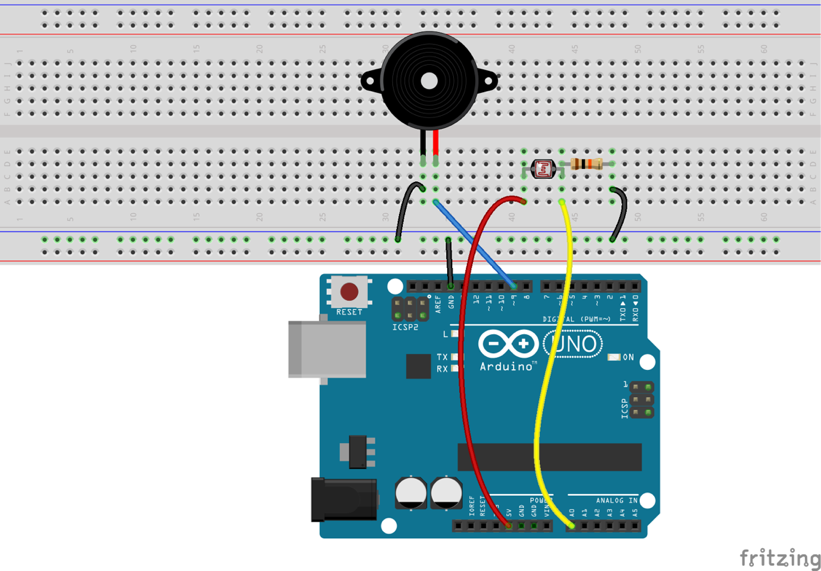
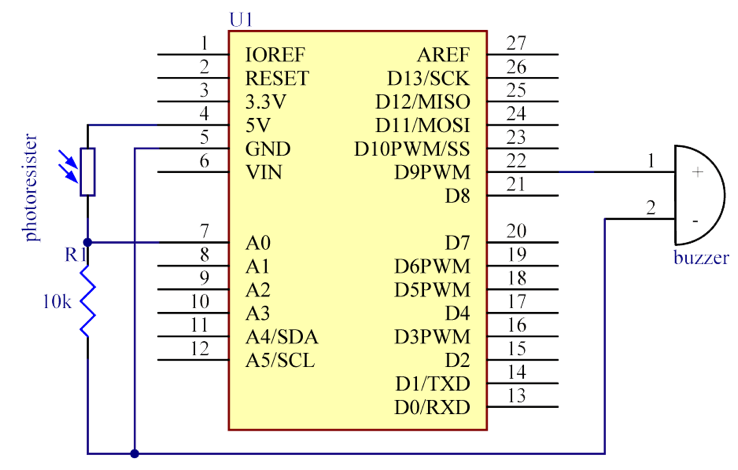

# Lekce 12: Ovládání zvuku pomocí světla

## Úvod

Práci s fotorezistorem už znáš. Teď s těmito znalostmi postavíš komplexnější projekt, kde intenzita světla bude ovládat frekvenci pípání bzučáku.

## Komponenty

- Arduino
- USB kabel
- Fotorezistor
- Aktivní bzučák
- 1× Rezistor (10 kΩ)
- Breadboard vodiče
- Breadboard

## Princip

Když posvítíš na fotorezistor, jeho odpor se sníží, a naopak.

V tomto projektu je výstup fotorezistoru přiveden na pin A0 Arduina a poté zpracován A/D převodníkem, který z analogového signálu vytvoří digitální. Tento signál používáme jako parametr funkce delay() v kódu, než se ozve bzučák. Pokud je dopadající světlo silné, je výsledná hodnota vyšší, což znamená, že bude bzučák pípat pomalu; je-li světlo slabé, výsledná hodnota je nižší a bzučák bude pípat rychleji.

## Postup experimentu

**Krok 1:** Vytvoř obvod

Schéma zapojení

<p align="center"> </p>

**Krok 2:** Napiš kód do Arduino IDE

**Kód** – soubor `Ovladani_zvuku_pomoci_svetla.ino`:

<!-- kod: Ovladani_zvuku_pomoci_svetla/Ovladani_zvuku_pomoci_svetla.ino -->
```cpp
/*
 * LaskaKit Arduino MAXI Starter kit – Lekce 12: Ovládání zvuku pomocí světla
 *
 * Bzučák pípá tím pomaleji, čím víc světla dopadá na fotorezistor.
 * Ve tmě pípá rychle.
 *
 * Zapojení:
 *   Fotorezistor: jeden vývod na 5V, druhý na A0
 *   Rezistor 10 kΩ: mezi A0 a GND
 *   Aktivní bzučák: + na pin 9, – na GND
 *
 * Knihovny: žádné (jen Arduino IDE)
 * Desky:    Arduino UNO R3, Arduino UNO R4 WiFi, Arduino Mega 2560
 *
 * Verze návodu 3.0 (10/2026)
 * LaskaKit | https://www.laskakit.cz | podpora@laskakit.cz
 */

const int fotoPin = A0;
const int bzucakPin = 9;

void setup() {
  pinMode(bzucakPin, OUTPUT);
}

void loop() {
  int svetlo = analogRead(fotoPin);  // 0–1023
  int pauza = map(svetlo, 0, 1023, 20, 1000);

  digitalWrite(bzucakPin, HIGH);  // pípnutí
  delay(30);
  digitalWrite(bzucakPin, LOW);
  delay(pauza);                   // čím víc světla, tím delší pauza
}
```
<!-- /kod -->

**Krok 3:** Připoj desku k počítači

**Krok 4:** Vyber desku a port

**Krok 5:** Zkompiluj a nahraj sketch do Arduina (Ctrl+U)

Pokud dáš fotorezistor do tmy, bude bzučák pípat rychle; vystavíš-li fotorezistor světlu, bude pípat pomalu.
