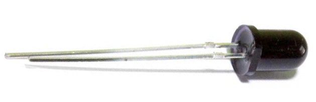
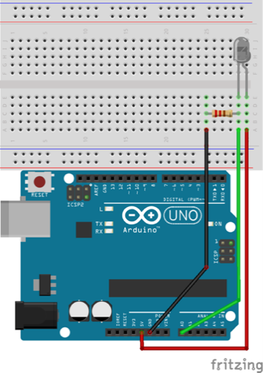
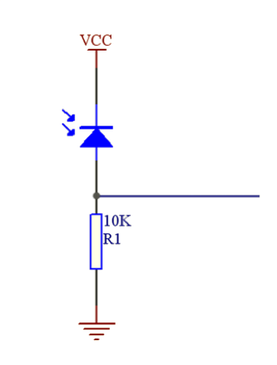

# Lekce 13: Senzor plamene

## Úvod

Tento senzor funguje na principu detekce infračerveného světla vlnové délky, která odpovídá běžným typům plamene. V tomto projektu si ukážeme, jak takový senzor použít.

## Komponenty

- Arduino
- USB kabel
- Senzor plamene
- 1x Rezistor (10kΩ)
- Breadboard vodiče

<p align="center"></p>

## Princip

Existuje několik typů senzoru plamene, ale v tomto projektu budeme využívat infračervené čidlo, které dokáže rozpoznat světlo o vlnové délce od 700nm do 1000nm (typická vlnová délka pro plameny obyčejných hořlavin). Infračervená zjistí intenzitu světla v okolí, a Arduino poté převede analogovou hodnotu do digitální podoby. 

## Postup projektu

**Krok 1:** Vytvoř obvod. Kratší kolík senzoru je katoda a ten druhý je anoda. Spoj katodu s 5V pinem a anodu s rezistorem; připoj druhý konec rezistoru ke GND, připoj jeden konec propojovacího vodiče na anodu, druhý konec k analogovému pinu, viz níže.

<p align="center"> </p>

**Krok 2:** Napiš kód do Arduino IDE

**Kód** – soubor `Senzor_plamene.ino`:

<!-- kod: Senzor_plamene/Senzor_plamene.ino -->
```cpp
/*
 * LaskaKit Arduino MAXI Starter kit – Lekce 13: Senzor plamene
 *
 * Infračervený senzor plamene reaguje na plamen (zapalovač, svíčku).
 * Když hodnota překročí práh, rozsvítí se LED na pinu 13.
 * Hodnoty sleduj v sériovém monitoru (9600 Bd) a podle nich si
 * uprav konstantu „prah“.
 *
 * Zapojení:
 *   Senzor plamene (IR dioda): kratší nožička (katoda) na 5V,
 *   delší nožička (anoda) na A0
 *   Odpor 10 kΩ: mezi A0 a GND
 *   LED: vestavěná LED „L“ na pinu 13
 *
 * Knihovny: žádné (jen Arduino IDE)
 * Desky:    Arduino UNO R3, Arduino UNO R4 WiFi, Arduino Mega 2560
 *
 * Verze návodu 3.0 (10/2026)
 * LaskaKit | https://www.laskakit.cz | podpora@laskakit.cz
 */

const int plamenPin = A0;
const int ledPin = 13;
const int prah = 30;  // práh detekce, uprav podle sériového monitoru

void setup() {
  pinMode(ledPin, OUTPUT);
  Serial.begin(9600);
}

void loop() {
  int hodnota = analogRead(plamenPin);
  Serial.println(hodnota);

  if (hodnota > prah) {
    digitalWrite(ledPin, HIGH);  // plamen detekován
  } else {
    digitalWrite(ledPin, LOW);
  }
  delay(200);
}
```
<!-- /kod -->

**Krok 3:** Připoj desku k počítači

**Krok 4:** Vyber desku a port

**Krok 5:** Zkompiluj a nahraj sketch do Arduina (Ctrl+U)

Když nyní rozsvítíš zapalovač nedaleko čidla, LED na pinu 13 na Arduino se rozsvítí.
