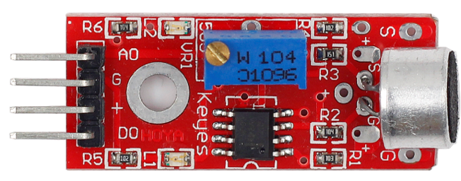
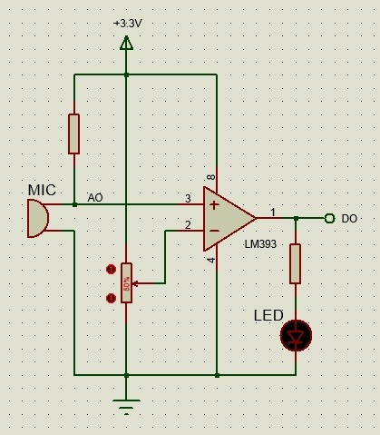
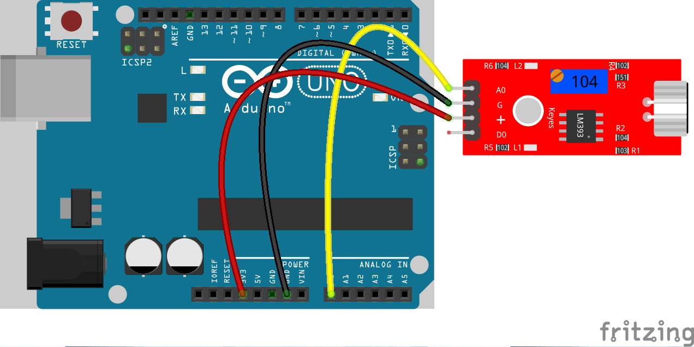

# Lekce 15: Zvukový senzor

## Úvod

Mikrofon v nějaké formě pravděpodobně máte připojen i k zařízení, na kterém tento manuál čtete. Tento modul mikrofonu ovšem funguje trochu jinak. Má dva výstupy:

A0: Analogový výstup, který se používá pro výstup napěťových signálů z mikrofonu v reálném čase. Analogický k funkci standardních mikrofonů.

D0: Dosáhne-li intenzita zvuku určité prahové hodnoty (nastavené pomocí potenciometru), bude na výstupu snímače vysoké nebo nízké úrovně.

<p align="center"></p>

## Komponenty

- Arduino
- USB kabel
- Zvukový senzor
- Breadboard vodiče

## Princip

Mikrofon umí konvertovat audio signál na analogový elektrický signál, pak stačí signál převést na digitální hodnotu s pomocí ADC, a na Arduino ji zpracovat. Níže je vidět schéma mikrofonu:

<p align="center"></p>

LM393 je komparátor napětí. Pokud je napětí na pinu 3 vyšší, než je invertující pin 2, výstupní pin 1 bude  mít log. hodnotu 1. V opačném případě log. hodnotu 0. 

Nejdříve nastav potenciometr, aby napětí na pinu 2 LM393 bylo méně než 5V. Pokud neslyšíš žádný zvuk, odpor mikrofonu je velmi velký. Napětí na pinu 3 LM393 je blízko k napájecímu napětí (5V). Na pinu DO je log.1 a LEDka svítí. Pokud slyšíš hluk, odpor mikrofonu klesne, pin DO modulu bude mít log.0 a LEDka se vypne.

## Postup projektu

**Krok 1:** Vytvoř obvod

| Zvukový senzor | Arduino |
|---|---|
| AO | A0 |
| G | GND |
| + | 3,3V |
| DO | nezapojuj |

<p align="center"></p>

**Krok 2:** Napiš kód do Arduino IDE

**Kód** – soubor `Zvukovy_senzor.ino`:

<!-- kod: Zvukovy_senzor/Zvukovy_senzor.ino -->
```cpp
/*
 * LaskaKit Arduino MAXI Starter kit – Lekce 15: Zvukový senzor
 *
 * Program měří, jak moc se mění signál z mikrofonu (rozkmit), a když
 * je zvuk dost hlasitý (tleskni, promluv), rozsvítí na 2 s LED na pinu 13.
 * Rozkmit vidíš v sériovém monitoru (9600 Bd) – podle něj si nastav
 * konstantu „prah“.
 *
 * Zapojení:
 *   Zvukový senzor: AO–A0, G–GND, + na 3,3V (výstup DO nezapojuješ)
 *   LED: vestavěná LED „L“ na pinu 13
 *
 * Knihovny: žádné (jen Arduino IDE)
 * Desky:    Arduino UNO R3, Arduino UNO R4 WiFi, Arduino Mega 2560
 *
 * Verze návodu 3.0 (10/2026)
 * LaskaKit | https://www.laskakit.cz | podpora@laskakit.cz
 */

const int ledPin = 13;
const int zvukPin = A0;
const int prah = 50;          // citlivost – menší číslo = citlivější
const int oknoMeren = 50;     // délka měření v ms

void setup() {
  pinMode(ledPin, OUTPUT);
  Serial.begin(9600);
}

void loop() {
  // Během 50 ms najdeme nejmenší a největší hodnotu signálu.
  // Rozdíl (rozkmit) odpovídá hlasitosti zvuku.
  int minimum = 1023;
  int maximum = 0;
  unsigned long start = millis();
  while (millis() - start < oknoMeren) {
    int hodnota = analogRead(zvukPin);
    if (hodnota < minimum) minimum = hodnota;
    if (hodnota > maximum) maximum = hodnota;
  }
  int rozkmit = maximum - minimum;
  Serial.println(rozkmit);

  if (rozkmit > prah) {
    digitalWrite(ledPin, HIGH);
    delay(2000);  // LED svítí 2 sekundy
    digitalWrite(ledPin, LOW);
  }
}
```
<!-- /kod -->

**Krok 3:** Připoj desku k počítači

**Krok 4:** Vyber desku a port

**Krok 5:** Zkompiluj a nahraj sketch do Arduina (Ctrl+U)

Když teď tleskneš nebo nahlas promluvíš do mikrofonu, LEDka připojená k pinu 13 na Arduinu se na 2 sekundy rozsvítí. V sériovém monitoru (9600 baud) vidíš, jak hlasitý zvuk byl. Citlivost změníš konstantou prah v programu.
