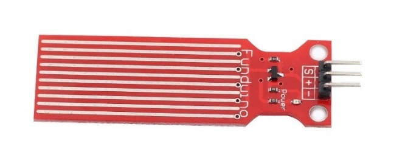
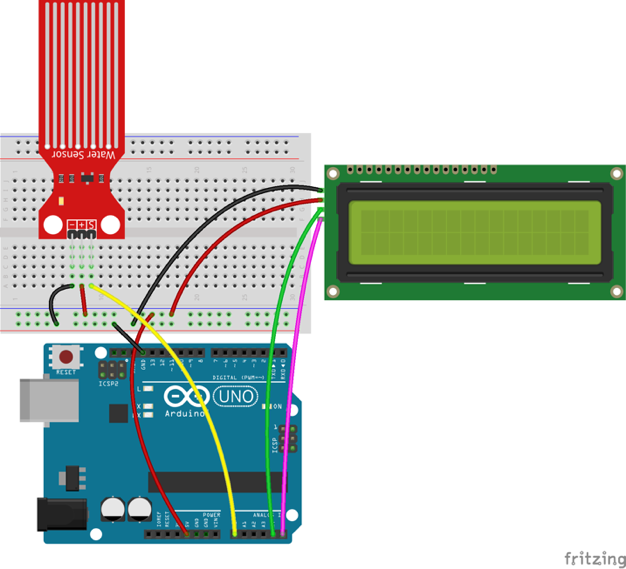
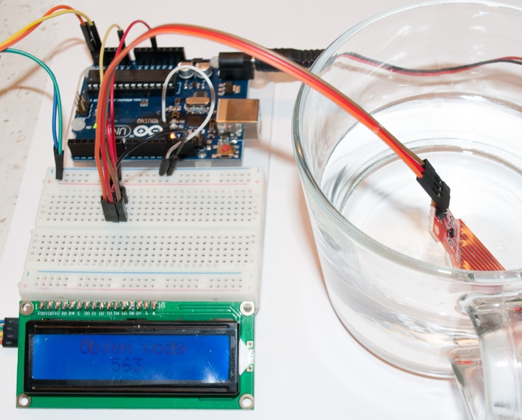

# Lekce 16: Senzor hladiny vody

## Úvod

V této lekci použijeme snímač hladiny vody na měření hloubky vody. Výsledek zobrazíme na LCD displeji.

## Komponenty

- Arduino
- Breadboard
- USB kabel
- Senzor hladiny vody
- 1× I2C LCD1602
- Breadboard vodiče

<p align="center"></p>

## Princip

Voda (pokud není destilovaná) je elektricky vodivá. Vodivost vody můžeme využít (mimo jiné) pro měření hloubky vody v nějaké nádobě. Základem senzoru je zesilovací obvod složený z tranzistoru a několika vodivých plošek hřebenového tvaru. Při umístění do vody budou tyto vodivé plošky měnit svůj odpor s hloubkou vody a převádět hloubku na elektrický signál. 

A/D převodníkem Arduina převedeme tento analogový signál na digitální a pak z něj vypočítáme hloubku, kterou vypíšeme na LCD.

## Postup projektu

**Krok 1:** Vytvoř obvod

<p align="center"> </p>

**Krok 2:** Napiš kód do Arduino IDE

**Kód** – soubor `Senzor_hladiny_vody.ino`:

<!-- kod: Senzor_hladiny_vody/Senzor_hladiny_vody.ino -->
```cpp
/*
 * LaskaKit Arduino MAXI Starter kit – Lekce 16: Senzor hladiny vody
 *
 * Čím hlouběji ponoříš senzor do vody, tím vyšší hodnotu uvidíš
 * na displeji I2C LCD1602. Hodnota je bez jednotek (0–1023).
 * Senzor neponořuj nad vyznačenou čáru – elektronika nesmí do vody.
 *
 * Zapojení:
 *   Senzor hladiny vody: – na GND, + na 5V, S na A0
 *   I2C LCD1602: GND–GND, VCC–5V, SDA/SCL podle lekce 6
 *
 * Knihovny: LiquidCrystal I2C (Frank de Brabander) – Správce knihoven
 * Desky:    Arduino UNO R3, Arduino UNO R4 WiFi, Arduino Mega 2560
 *
 * Verze návodu 3.0 (10/2026)
 * LaskaKit | https://www.laskakit.cz | podpora@laskakit.cz
 */

#include <Wire.h>
#include <LiquidCrystal_I2C.h>

LiquidCrystal_I2C lcd(0x27, 16, 2);
const int senzorPin = A0;

void setup() {
  lcd.init();
  lcd.backlight();
  lcd.setCursor(0, 0);
  lcd.print("  Hladina vody  ");
}

void loop() {
  int hodnota = analogRead(senzorPin);
  lcd.setCursor(0, 1);
  lcd.print("                ");  // smazat druhý řádek
  lcd.setCursor(6, 1);
  lcd.print(hodnota);
  delay(300);
}
```
<!-- /kod -->

> **Poznámka:** Potřebuješ knihovnu LiquidCrystal I2C – viz kapitola Instalace knihoven.


**Krok 3:** Připoj desku k počítači

**Krok 4:** Vyber desku a port

**Krok 5:** Zkompiluj a nahraj sketch do Arduina (Ctrl+U)

Když teď ponoříš čidlo do vody, uvidíš na LCD displeji hloubku (jako hodnotu bez jednotek).
