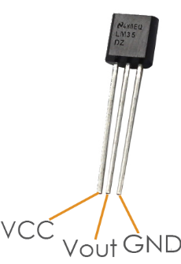
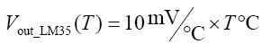
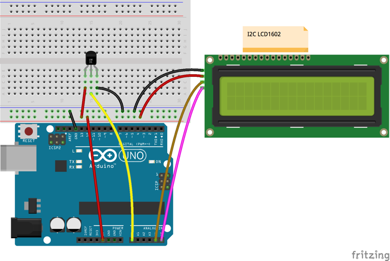

# Lekce 17: Teplotní čidlo LM-35

## Úvod

LM35 od firmy National Semiconductor je teplotní čidlo, které převádí teplotu na předvídatelé napětí s maximální nelinearitou ±0,75 °C v rozsahu teplot -55 °C až 150 °C (zjednodušeně řečeno, ve standardním rozsahu teplot bývá přesné na ±0,75°C). Často používaná varianta obvodu je zapouzdřena v malém plastovém pouzdře TO-92, ale existuje i verze ve větším plastovém pouzdře TO-220 a verze v kovovém pouzdře TO-46. Převodník se vyrábí i v provedení SMD pro montáž přímo na povrch plošného spoje (SMT).

Napájecí napětí převodníku – pokud se pohybuje v rozsahu 4 V až 20 V – nemusí být stabilizované a převodník lze tudíž napájet přímo z baterie. V základním zapojení pro měření teploty je převodník připojen ke zdroji napětí, což může být např. 9V baterie, a na výstupu převodníku je voltmetr.

<p align="center"></p>

Pokud se mají měřit kladné i záporné teploty, zapojení vychází o něco složitěji. LM35 se používá i jako převodník teplota/napětí pro Arduino.

## Komponenty

- Arduino
- Breadboard
- USB kabel
- Teplotní čidlo LM-35
- I2C LCD1602
- Breadboard vodiče

## Princip

Každý jeden stupeň celsia, který naměří čidlo, vyprodukuje na výstupu 10 mV (tj. _převodní koeficient_ je 10mV/°C). Prakticky to znamená, že se např. při teplotě 150 °C se na výstupu převodníku objeví napětí 1500 mV. Bude-li měřená teplota záporná, např. −40 °C, bude i výstupní napětí záporné (−400 mV).

Vzorec výpočtu je následující:

<p align="center"></p>

## Postup experimentu

**Krok 1:** Vytvoř obvod

<p align="center"></p>

**Krok 2:** Napiš kód do Arduino IDE

**Kód** – soubor `Teplotni_cidlo_LM35.ino`:

<!-- kod: Teplotni_cidlo_LM35/Teplotni_cidlo_LM35.ino -->
```cpp
/*
 * LaskaKit Arduino MAXI Starter kit – Lekce 17: Teplotní čidlo LM35
 *
 * Změří teplotu čidlem LM35 a zobrazí ji na displeji I2C LCD1602.
 * LM35 dává 10 mV na každý °C (25 °C = 250 mV).
 * Program průměruje 20 měření, aby údaj neskákal.
 *
 * Zapojení:
 *   LM35 (plochou stranou k sobě, zleva): +Vs na 5V, Vout na A0, GND na GND
 *   I2C LCD1602: GND–GND, VCC–5V, SDA/SCL podle lekce 6
 *
 * Knihovny: LiquidCrystal I2C (Frank de Brabander) – Správce knihoven
 * Desky:    Arduino UNO R3, Arduino UNO R4 WiFi, Arduino Mega 2560
 *
 * Verze návodu 3.0 (10/2026)
 * LaskaKit | https://www.laskakit.cz | podpora@laskakit.cz
 */

#include <Wire.h>
#include <LiquidCrystal_I2C.h>

LiquidCrystal_I2C lcd(0x27, 16, 2);
const int lm35Pin = A0;
const int pocetMereni = 20;

void setup() {
  lcd.init();
  lcd.backlight();
  lcd.setCursor(6, 0);
  lcd.print("LM35");
}

void loop() {
  // průměr z několika měření potlačí šum
  long soucet = 0;
  for (int i = 0; i < pocetMereni; i++) {
    soucet += analogRead(lm35Pin);
    delay(5);
  }
  float prumer = soucet / (float)pocetMereni;

  float napeti_mV = prumer * 5000.0 / 1023.0;  // převod na milivolty
  float teplota = napeti_mV / 10.0;            // 10 mV = 1 °C

  lcd.setCursor(0, 1);
  lcd.print("Teplota: ");
  lcd.print(teplota, 1);
  lcd.print((char)223);  // znak stupně °
  lcd.print("C ");
  delay(500);
}
```
<!-- /kod -->

> **Poznámka:** Potřebuješ knihovnu LiquidCrystal I2C – viz kapitola Instalace knihoven.

**Krok 3:** Připoj desku k počítači

**Krok 4:** Vyber desku a port

**Krok 5:** Zkompiluj a nahraj sketch do Arduina (Ctrl+U)

Teď uvidíš na displeji teplotu.
