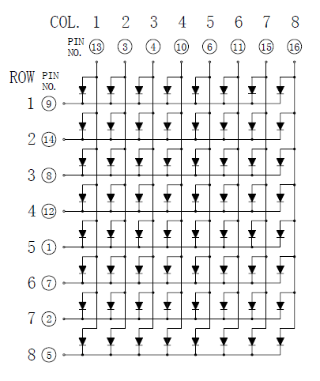
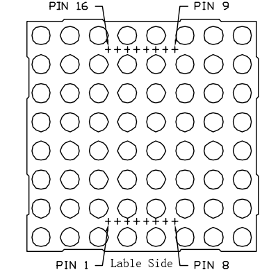
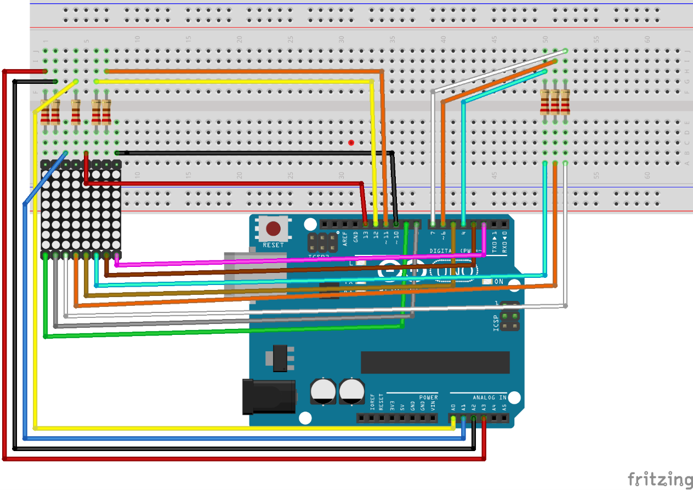

# Lekce 20: 8x8 LED matice

## Úvod

Maticové LED displeje jsou přesně to, co si myslíš - "mřížka" propojených ledek. Mají mnoho výhod oproti LCD nebo sedmisegmentovkám, se kterými už máš parxi. Oproti LCD jsou větší a lépe čitelné, a narozdíl od sedmisegmentovek nemají limitace v počtu znaků které na nich lze zobrazit. Navíc díky způsobu zapojení LED stačí 16 pinů pro 64 diod.

<p align="center"></p>

## Komponenty

- Arduino
- USB kabel
- LED matice 8x8
- 8x Rezistor (220Ω)
- Breadboard
- Breadboard vodiče

<p align="center"></p>

## Princip

Pin číslování odpovídá výše uvedenému řádku a sloupci:

| Sloupec (COL) | 1 | 2 | 3 | 4 | 5 | 6 | 7 | 8 |
|---|---|---|---|---|---|---|---|---|
| č. pinu matice | 13 | 3 | 4 | 10 | 6 | 11 | 15 | 16 |

| **Řádek (ROW)** | 1 | 2 | 3 | 4 | 5 | 6 | 7 | 8 |
| č. pinu matice | 9 | 14 | 8 | 12 | 1 | 7 | 2 | 5 |

Princip 8x8 maticového LED displeje:

8x8 LED matice se skládá z 64 LED a každá LEDka je umístěna na průsečíku řádku a sloupce. Když je elektrická úroveň určité řady vysoká a elektrická úroveň určitého sloupce nízká, pak se odpovídající LED rozsvítí. Chceš-li rozsvítit LED na první pokus, měl bys nastavit řádek 1 na vysokou úroveň (log. 1) a sloupec 1 na nízkou úroveň (log. 0). Pak se LED na prvním bodě rozsvítí. Chceš-li rozsvítit světlo LED na prvním řádku, měl bys nastavit řádek 1 na log. 1 a sloupce (1, 2, 3, 4, 5, 6, 7, 8) na log. 0. Pak se všechny LED diody na prvním řádku rozsvítí.

## Postup projektu

**Krok 1:** Vytvoř obvod

<p align="center"></p>

**Krok 2:** Napiš kód do Arduino IDE

**Kód** – soubor `LED_matice_8x8.ino`:

<!-- kod: LED_matice_8x8/LED_matice_8x8.ino -->
```cpp
/*
 * LaskaKit Arduino MAXI Starter kit – Lekce 20: 8×8 LED matice
 *
 * Na matici 8×8 se postupně objevují znaky L A S K ♥ D U I N O.
 * Matice se rozsvěcí po řádcích tak rychle, že oko vidí celý znak.
 *
 * Zapojení:
 *   Řádky matice: R1–10, R2–A1, R3–2, R4–13, R5–9, R6–3, R7–8, R8–5
 *   Sloupce přes odpor 220 Ω: C1–A0, C2–7, C3–6, C4–11, C5–4, C6–12, C7–A2, C8–A3
 *   (čísla pinů matice viz tabulka v návodu)
 *
 * Knihovny: žádné (jen Arduino IDE)
 * Desky:    Arduino UNO R3, Arduino UNO R4 WiFi, Arduino Mega 2560
 *
 * Verze návodu 3.0 (10/2026)
 * LaskaKit | https://www.laskakit.cz | podpora@laskakit.cz
 */

// piny řádků a sloupců matice
const byte radky[8]   = {10, A1, 2, 13, 9, 3, 8, 5};
const byte sloupce[8] = {A0, 7, 6, 11, 4, 12, A2, A3};

// znaky 8×8 – každý bajt je jeden řádek, bit 0 = sloupec 1
const byte znakL[8] = {0x0F, 0x06, 0x06, 0x06, 0x46, 0x66, 0x7F, 0x00};
const byte znakA[8] = {0x0C, 0x1E, 0x33, 0x33, 0x3F, 0x33, 0x33, 0x00};
const byte znakS[8] = {0x1E, 0x33, 0x07, 0x0E, 0x38, 0x33, 0x1E, 0x00};
const byte znakK[8] = {0x67, 0x66, 0x36, 0x1E, 0x36, 0x66, 0x67, 0x00};
const byte znakD[8] = {0x1F, 0x36, 0x66, 0x66, 0x66, 0x36, 0x1F, 0x00};
const byte znakU[8] = {0x33, 0x33, 0x33, 0x33, 0x33, 0x33, 0x3F, 0x00};
const byte znakI[8] = {0x1E, 0x0C, 0x0C, 0x0C, 0x0C, 0x0C, 0x1E, 0x00};
const byte znakN[8] = {0x63, 0x67, 0x6F, 0x7B, 0x73, 0x63, 0x63, 0x00};
const byte znakO[8] = {0x1C, 0x36, 0x63, 0x63, 0x63, 0x36, 0x1C, 0x00};
const byte srdce[8] = {
  0b00000000,
  0b01100110,
  0b11111111,
  0b11111111,
  0b01111110,
  0b00111100,
  0b00011000,
  0b00000000
};

// pořadí znaků v nápisu
const byte *napis[] = {znakL, znakA, znakS, znakK, srdce, znakD, znakU, znakI, znakN, znakO};
const int pocetZnaku = sizeof(napis) / sizeof(napis[0]);

void setup() {
  for (int i = 0; i < 8; i++) {
    pinMode(radky[i], OUTPUT);
    pinMode(sloupce[i], OUTPUT);
    digitalWrite(radky[i], HIGH);  // všechny řádky vypnuté
  }
}

void loop() {
  for (int z = 0; z < pocetZnaku; z++) {
    zobrazZnak(napis[z], 600);  // znak na 600 ms
    delay(150);                 // krátká mezera mezi znaky
  }
  delay(1000);
}

// Zobrazí znak po zadanou dobu (ms)
void zobrazZnak(const byte znak[8], unsigned long doba) {
  unsigned long start = millis();
  while (millis() - start < doba) {
    for (int r = 0; r < 8; r++) {
      nastavSloupce(znak[r]);
      digitalWrite(radky[r], LOW);   // zapnout řádek
      delay(2);
      digitalWrite(radky[r], HIGH);  // vypnout řádek
    }
  }
}

void nastavSloupce(byte data) {
  for (int s = 0; s < 8; s++) {
    digitalWrite(sloupce[s], (data >> s) & 0x01);
  }
}
```
<!-- /kod -->

**Krok 3:** Připoj desku k počítači

**Krok 4:** Vyber desku a port

**Krok 5:** Zkompiluj a nahraj sketch do Arduina (Ctrl+U)

Na matici se postupně objeví znaky L, A, S, K, ♥, D, U, I, N, O – dohromady „LASK♥DUINO“.
