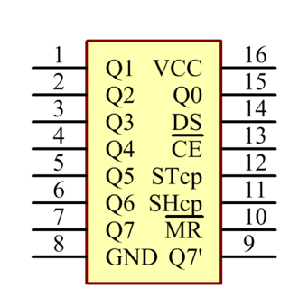
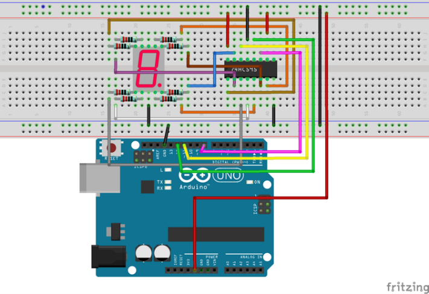
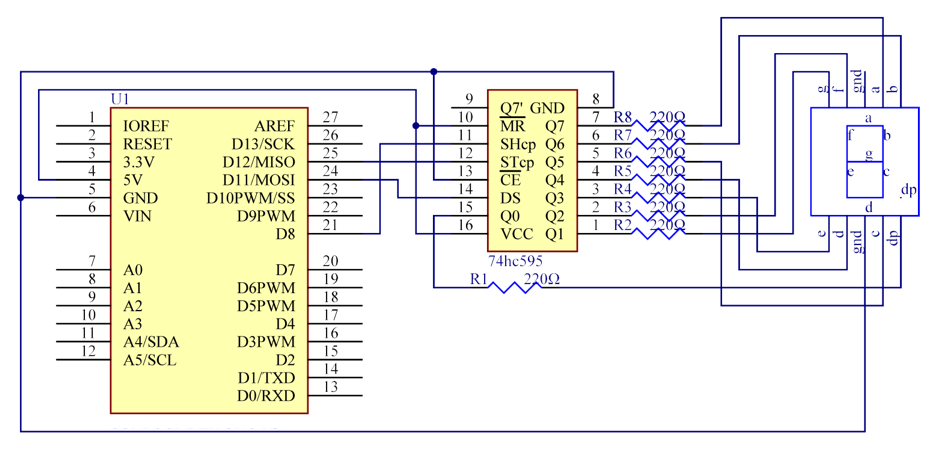

# Lekce 22: Řízení sedmisegmentového displeje s 74HC595

## Úvod

V lekci 18 jsme si ukázali, jak řídit sedmisegmentové displeje pomocí Arduina bez speciálních obvodů. To ovšem není jediná možnost, jak řídit několik sedmisegmentových displejů pomocí Arduina. Dalším způsobem je použití posuvných registrů. Zde použijeme osmibitový posuvný registr 74HC595.

## Komponenty

- Arduino
- 8× Rezistor (220 Ω)
- Posuvný registr 74HC595
- Breadboard vodiče
- Breadboard
- USB kabel
- Sedmisegmentový LED displej

## Princip

Co vůbec posuvný registr dělá? V zásadě je to soustava klopných obvodů (obvod, který v sobě drží stav logické 1 nebo 0, a v tomto případě dokonce i stav vysoké impedance (HZ)), kterými se logická informace posouvá dále pomocí hodinového impulsu. Posuvný registr má 3 vstupy, které pro nás budou důležité (SER, SRCLK, SCLK), a v našem případě 8 výstupů (Q0–Q7). 74HC595 se skládá ze tří částí: posuvného registru, záchytného registru a třístavových výstupů. 

K ovládání 8 výstupů jsou zapotřebí pouze 3 piny Arduina. 74HC595 je široce používán k řízení např. segmentových displejů. Výstupní piny můžeme nastavit na log. 1, na log. 0, nebo do stavu vysoké impedance. Navíc jich lze propojit několik mezi sebou (takzvaně "daisy-chain").

## Zapojení

Propojení 74HC595, Arduina a sedmisegmentovky může vypadat takto:

<p align="center"></p>

Piny 74HC595 a jejich funkce:

Q0–Q7: osm výstupů, které dokážou řídit 8 LED nebo 8 pinů sedmisegmentového displeje

Q7S: Serial data output pin, který slouží k propojení s dalším obvodem 74HC595

MR: Reset pin, aktivní na log.0; zapojíme ho na +5V

SH: Shift register clock input je určen pro hodinový signál

ST: Storage register clock input, na náběžné hraně přesune údaje z posuvného registru do paměťového

OE: Output enable pin, aktivní na log.0; zapojíme ho na GND

Ds: Serial data input pin, sem se zapisují data

Zde se používá funkce shiftOut(), která je součástí Arduino IDE. Jednoduše zadej číslo mezi 0 a 255 a registr ho převede na 8bitové binární číslo a paralelně ho vyvede na výstupy. To ti umožní snadno ovládat 8 pinů sedmisegmentového displeje a zobrazit libovolný vzor.

## Postup experimentu

**Krok 1:** Vytvoř obvod (schéma je pro displej se společnou katodou – CC)

<p align="center"> </p>

Máš displej se společnou anodou (CA)? Zapoj jeho společný vývod (COM) na 5V místo GND a v programu nastav SPOLECNA\_ANODA na true. Zbytek zapojení zůstává stejný.

**Krok 2:** Napiš kód do Arduino IDE

**Kód** – soubor `Sedmisegment_74HC595.ino`:

<!-- kod: Sedmisegment_74HC595/Sedmisegment_74HC595.ino -->
```cpp
/*
 * LaskaKit Arduino MAXI Starter kit – Lekce 22: Řízení sedmisegmentového displeje s 74HC595
 *
 * Posuvný registr 74HC595 ovládá všech 8 segmentů displeje pomocí
 * pouhých 3 pinů Arduina. Na displeji se postupně zobrazí znaky 0 až F.
 * Podle typu displeje nastav řádek SPOLECNA_ANODA.
 *
 * Zapojení:
 *   74HC595: DS (14)–11, SH_CP (11)–8, ST_CP (12)–12,
 *   VCC (16) a MR (10) na 5V, GND (8) a OE (13) na GND
 *   Výstupy Q0–Q7 přes rezistor 220 Ω na segmenty podle schématu v návodu
 *   Společný vývod displeje: CC na GND, CA na 5V
 *
 * Knihovny: žádné (jen Arduino IDE)
 * Desky:    Arduino UNO R3, Arduino UNO R4 WiFi, Arduino Mega 2560
 *
 * Verze návodu 3.0 (10/2026)
 * LaskaKit | https://www.laskakit.cz | podpora@laskakit.cz
 */

// false = společná katoda (CC), true = společná anoda (CA)
const bool SPOLECNA_ANODA = false;

const int latchPin = 12;  // ST_CP
const int clockPin = 8;   // SH_CP
const int dataPin = 11;   // DS

// kódy znaků 0,1,2,3,4,5,6,7,8,9,A,b,C,d,E,F pro zapojení podle schématu
const byte znaky[16] = {250, 96, 220, 244, 102, 182, 190, 224,
                        254, 246, 238, 62, 154, 124, 158, 142};

void setup() {
  pinMode(latchPin, OUTPUT);
  pinMode(clockPin, OUTPUT);
  pinMode(dataPin, OUTPUT);
}

void loop() {
  for (int i = 0; i < 16; i++) {
    byte data = znaky[i];
    if (SPOLECNA_ANODA) {
      data = ~data;  // u CA displeje svítí segment při LOW -> bity obrátit
    }
    digitalWrite(latchPin, LOW);                     // začátek zápisu
    shiftOut(dataPin, clockPin, MSBFIRST, data);     // poslat 8 bitů
    digitalWrite(latchPin, HIGH);                    // přenést na výstupy
    delay(1000);
  }
}
```
<!-- /kod -->

**Krok 3:** Připoj desku k počítači

**Krok 4:** Vyber desku a port

**Krok 5:** Zkompiluj a nahraj sketch do Arduina (Ctrl+U)

Nyní se na displeji postupně zobrazí znaky 0 až F.
