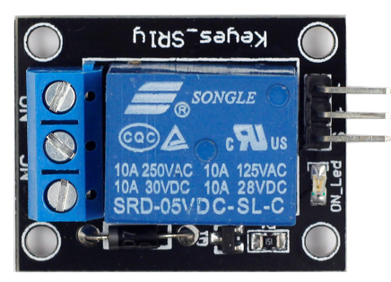
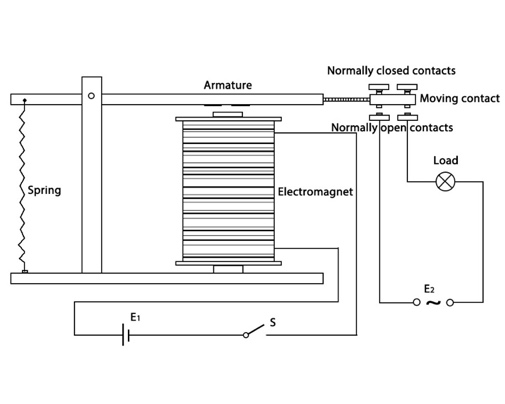
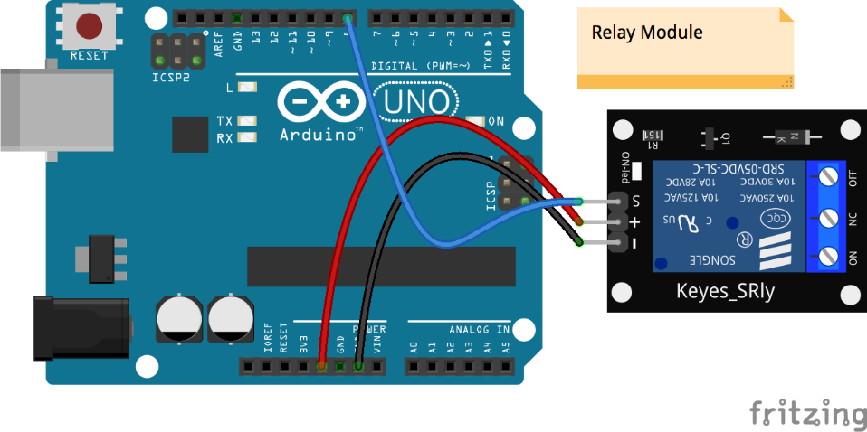

# Lekce 25: Modul relé

## Úvod

Elektromagnetické relé je součástka, která obsahuje kontakty které lze spínat jednoduchým signálem. Relé bylo vynalezeno roku 1835 Josefem Henrym a původně bylo využíváno jako mechanický zesilovač na telegrafních linkách. Jeho název pochází z přepřahacích stanic na kurýrních cestách.

Relé se dodnes používá v širokém spektru elektronických obvodů, i když jeho funkci v mnoha případech přebírají obvody založené na polovodičích. Relé má totiž i své výhody. Na rozdíl od polovodičů, relé obvykle zajišťuje galvanické oddělení řídícího a řízeného obvodu, což znamená, že 5V arduino nijak nemůže přijít do styku s 230V které relé často ovládá.

## Komponenty

- Arduino
- USB kabel
- 1-kanál relé modul
- Dupont kabely samec-samice

<p align="center"></p>

## Princip

Relé se v základním provedení skládá z cívky (elektromagnetu) navinuté na jádru z měkkého feromagnetického materiálu (materil který se zmagnetizuje jiným magnetickým materiálem, tj. "magnetický jako železo"). Magnetický obvod je uzavřen pohyblivou kotvou. Kotva je pružinou uváděna do klidové polohy a současně se opírá o pohyblivý kontakt. Po připojení cívky na elektrický zdroj vyvolá proud cívkou v magnetickém obvodu magnetický tok. Magnetický tok vyvolá přitažlivou sílu na kotvu, která přemůže sílu v pružině a překlopí kontakt. Po odpojení el. proudu se kotva a kontakt vrátí do předchozího, klidového stavu.

<p align="center"></p>

Většina modulů relé sepne, když na vstup S pošleme z Arduina log. 1 (5 V). Tranzistor na modulu se otevře, cívka relé přitáhne kotvu, spínací kontakt (NO) se uzavře a rozpínací (NC) se rozpojí. Když pošleme log. 0, relé se vrátí do původního stavu. Některé moduly spínají obráceně, při log. 0 – pak v programu změň RELE\_ZAPNUTO na LOW.

## Postup projektu

**Krok 1:** Vytvoř obvod

<p align="center"></p>

**Krok 2:** Napiš kód do Arduino IDE

**Kód** – soubor `Modul_rele.ino`:

<!-- kod: Modul_rele/Modul_rele.ino -->
```cpp
/*
 * LaskaKit Arduino MAXI Starter kit – Lekce 25: Modul relé
 *
 * Relé každou sekundu sepne a rozepne – uslyšíš cvakání
 * a na modulu bliká kontrolka.
 * Většina modulů relé spíná při HIGH. Pokud tvůj modul spíná obráceně
 * (kontrolka svítí, když má být relé vypnuté), změň RELE_ZAPNUTO na LOW.
 *
 * Zapojení:
 *   Modul relé: S (IN) na pin 8, + (VCC) na 5V, – (GND) na GND
 *
 * Knihovny: žádné (jen Arduino IDE)
 * Desky:    Arduino UNO R3, Arduino UNO R4 WiFi, Arduino Mega 2560
 *
 * Verze návodu 3.0 (10/2026)
 * LaskaKit | https://www.laskakit.cz | podpora@laskakit.cz
 */

const int relePin = 8;
const int RELE_ZAPNUTO = HIGH;  // u modulů spínaných nulou změň na LOW
const int RELE_VYPNUTO = !RELE_ZAPNUTO;

void setup() {
  pinMode(relePin, OUTPUT);
  digitalWrite(relePin, RELE_VYPNUTO);
}

void loop() {
  digitalWrite(relePin, RELE_ZAPNUTO);  // sepnout
  delay(1000);
  digitalWrite(relePin, RELE_VYPNUTO);  // rozepnout
  delay(1000);
}
```
<!-- /kod -->

**Krok 3:** Připoj desku k počítači

**Krok 4:** Vyber desku a port

**Krok 5:** Zkompiluj a nahraj sketch do Arduina (Ctrl+U)

Teď uslyšíš známé „tik-tak, tik-tak“. To znamená, že normálně uzavřený kontakt se otevře a naopak, normálně otevřený kontakt se uzavře.
