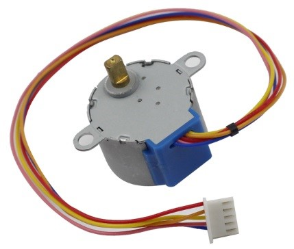
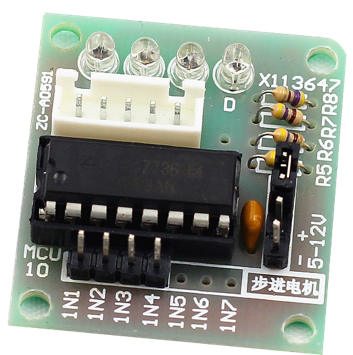
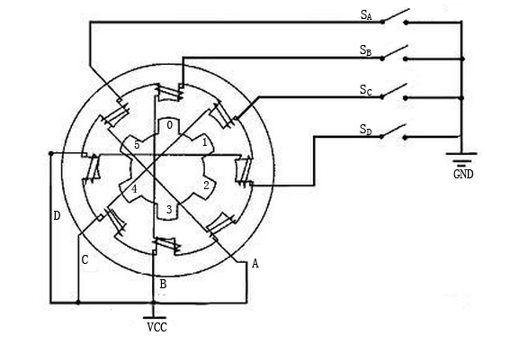
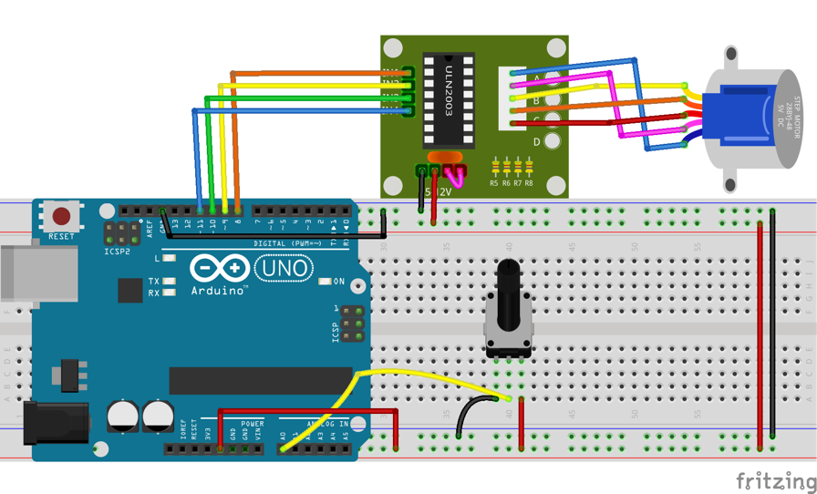
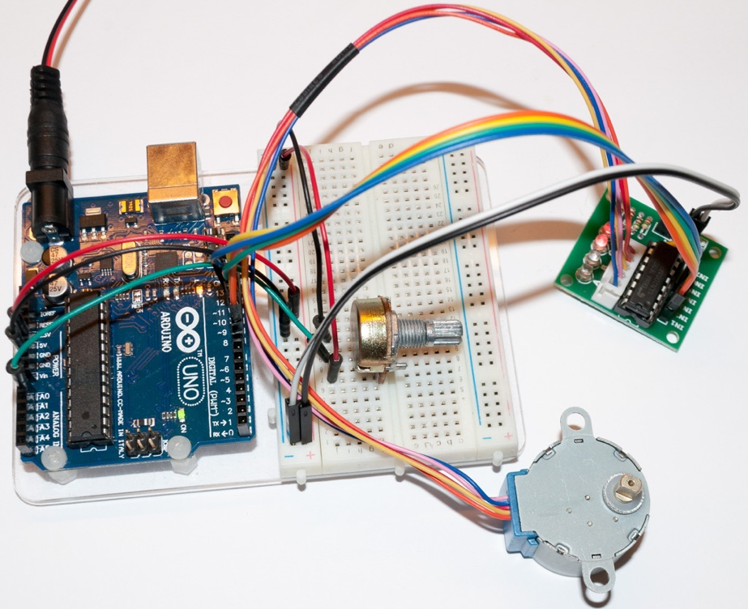

# Lekce 26: Krokový motor

## Úvod

Krokové motory, díky své jedinečné konstrukci, mohou být ovládány s vysokou přesností a bez jakýchkoli mechanismů zpětné vazby. Na hřídel krokového motoru je namontována série magnetů, řízena za pomoci elektromagnetických cívek, které budí elektrické impulzy. Díky tomuto mechanickému zpracování se krokové motory dokáží se přesně otáčet dopředu a dozadu v pomalých „krocích“. Dokonce se dokáži otočit i o půl nebo čvtvrtkrok.

Existují dva typy krokových motorů – unipolarní a bipolarní. Je velmi důležité, abys věděl, s jakým typem pracuješ. V tomto experimentu použijeme unipolarní krokový motor.

Arduino desky nebo kontrolery nemohou přímo řídit krokové motory. Je tedy nezbytný řídící řadič krokového motoru (jako je ukázáno na následujícím obrázku).

## Komponenty

- Arduino
- USB kabel
- Potenciometr
- Krokový motor
- Řadič krokový motor
- Breadboard vodiče
- Breadboard

<p align="center"></p>

<p align="center"></p>

## Princip

Tento krokový motor je čtyřfázový a používá stejnosměrný napájecí zdroj. Po napájení všech fází motoru dle příslušného pořadí se začne otáčet krok za krokem. Schematický diagram čtyřfázového krokového motoru je znázorněn níže:

<p align="center"></p>

Na obrázku je uprostřed motoru rotor – permanentní magnet ve tvaru ozubeného kola. Okolo rotoru je 0 až 5 zubů. Více jich je venku. Tam je 8 magnetických pólů, každý se dvěma protilehlými a ty jsou spojené vinutou cívkou. Takže tvoří čtyři páry od A do D. Ty se nazývají fáze. Mají čtyři vodiče připojené ke spínačům SA, SB, SC a SD. Proto jsou čtyři fáze paralelně v obvodu a dva magnetické póly v jedné fázi jsou v sérii.

Níže se dočteš, jak 4-fázový krokový motor funguje. Pokud je to příliš technické, tak není ostuda se k tomuto vysvětlení dostat později ;)

Na začátku je spínač SB zapnutý, spínače SA, SC a SD jsou vypnuty a magnetické póly ve fázi B jsou zarovnány s ozubením 0 a 3 rotoru. Současně 1 a 4 vytváří střídavě uspořádané zuby s C- a D-fází pólu. Zuby 2 a 5 vytvářejí odstupňované zuby s póly D a A fáze. Když je spínač SC zapnutý, spínače SB, SA a SD jsou vypnuty, rotor se otáčí pod magnetickým polem C vinutí a mezi zubem 1 a 4. Potom se zub 1 a 4 vyrovná s magnetickými póly C-fázového vinutí. Když zub 0 a 3 vytváří stoupavé zuby s póly fáze A a B, zuby 2 a 5 vytváří stoupavé zuby s magnetickými póly A až D. Podobné situace se neustále opakují. Zapněte fáze A, B, C a D, rotor se začne otáčet v pořadí of A, B, C a D.

Čtyřfázový krokový motor má tři provozní režimy: samostatný čtyř-krokový, dvojitý čtyř-krokový a osmi-krokový. Krokový úhel pro samostatný čtyř-krokový a dvojitý čtyř-krokový režim je stejný, ale hnací moment pro samostatný čtyř-krokový režim je menší. Krokový úhel pro osmi-krokový režim je poloviční, než u režimu samostatného čtyř-krokového a dvojitého čtyř-krokového. Osmistupňový provozní režim tak může udržet vysoký hnací moment a zlepšit přesnost řízení. V tomto experimentu necháváme krokový motor pracovat v osmi-krokovém režimu.

Pokud chcete použít motor v obvodu, musíte použít řídící desku. Řadič krokového motoru ULN2003 je 7-kanálový invertorový obvod. To znamená, že když je konec vstupu na vysoké úrovni, konec výstupu ULN2003 je na nízké úrovni, a naopak. Pokud je na IN1 vysoká úroveň a nízká úroveň na IN2, IN3 a IN4, pak je konec výstupu OUT1 na nízké úrovni a všechny ostatní konce jsou na úrovni vysoké. To tedy znamená, že D1 se rozsvítí, spínač SA se zapne a krokový motor se začne otáčet. Tato situace se bude stále opakovat. Proto stačí dát krokovému motoru určitou časovou posloupnost. Ten se pak bude postupně otáčet. ULN2003 se zde používá k poskytnutí konkrétních časových sekvencí pro krokový motor.

## Postup projektu

**Krok 1:** Vytvoř obvod

Zapojení mezi Krokovým motorem-řadičem a Arduino:

<p align="center"></p>

| Řadič ULN2003 | Arduino |
|---|---|
| IN1 | 8 |
| IN2 | 9 |
| IN3 | 10 |
| IN4 | 11 |
| GND | GND |
| VCC | 5v |

**Krok 2:** Napiš kód do Arduino IDE

> **Poznámka:** Knihovna Stepper je součástí Arduino IDE. V programu jsou piny v pořadí 8, 10, 9, 11 – to není chyba, motor 28BYJ-48 je tak potřebuje, jinak se jen chvěje na místě.

**Kód** – soubor `Krokovy_motor.ino`:

<!-- kod: Krokovy_motor/Krokovy_motor.ino -->
```cpp
/*
 * LaskaKit Arduino MAXI Starter kit – Lekce 26: Krokový motor
 *
 * Hřídel krokového motoru 28BYJ-48 sleduje natočení potenciometru:
 * celý rozsah potenciometru odpovídá jedné otáčce hřídele.
 * Motor má s převodovkou 2048 kroků na otáčku. Knihovna Stepper
 * potřebuje u řadiče ULN2003 piny v pořadí IN1, IN3, IN2, IN4.
 *
 * Zapojení:
 *   Řadič ULN2003: IN1–8, IN2–9, IN3–10, IN4–11, – na GND, + na 5V
 *   Motor: bílý konektor do řadiče
 *   Potenciometr: krajní vývody na 5V a GND, prostřední na A0
 *
 * Knihovny: Stepper (součást Arduino IDE)
 * Desky:    Arduino UNO R3, Arduino UNO R4 WiFi, Arduino Mega 2560
 *
 * Verze návodu 3.0 (10/2026)
 * LaskaKit | https://www.laskakit.cz | podpora@laskakit.cz
 */

#include <Stepper.h>

const int krokuNaOtacku = 2048;  // 28BYJ-48 s převodovkou

// Pořadí pinů 8, 10, 9, 11 (IN1, IN3, IN2, IN4) je pro 28BYJ-48 nutné,
// jinak motor jen cuká na místě.
Stepper motor(krokuNaOtacku, 8, 10, 9, 11);

const int potPin = A0;
int predchoziPoloha = 0;

void setup() {
  motor.setSpeed(10);  // otáčky za minutu (28BYJ-48 zvládne max. cca 15)
  predchoziPoloha = map(analogRead(potPin), 0, 1023, 0, krokuNaOtacku);
}

void loop() {
  // poloha potenciometru převedená na kroky motoru
  int poloha = map(analogRead(potPin), 0, 1023, 0, krokuNaOtacku);
  int rozdil = poloha - predchoziPoloha;

  // malé změny ignorujeme, aby motor necukal kvůli šumu
  if (abs(rozdil) > 8) {
    motor.step(rozdil);
    predchoziPoloha = poloha;
  }
}
```
<!-- /kod -->

**Krok 3:** Připoj desku k počítači

**Krok 4:** Vyber desku a port

**Krok 5:** Zkompiluj a nahraj sketch do Arduina (Ctrl+U)

Nyní otáčej potenciometrem a hřídel motoru ho bude následovat – celý rozsah potenciometru odpovídá jedné otáčce hřídele.

<p align="center"></p>
