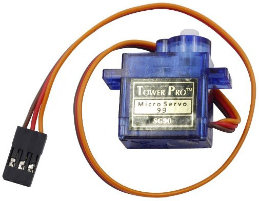

# Lekce 27: Servo

## Úvod

Servomotor (servo) je typ motoru, který ví, v jaké pozici se nachází, a tak se dokáže otočit o konkrétní úhel. Levná serva se často ovládají pomocí PWM modulace, která servu řekne, do jaké pozice se má otočit.

Servo má tři vodiče. Hnědý vodič je GND, červený vodič je VCC a oranžový vodič je signál.

## Komponenty

- Arduino
- USB kabel
- Servomotor
- Breadboard vodiče

<p align="center"></p>

## Princip

Servo se skládá z pláště, obvodové desky, bezjádrového motoru, převodovky a detekce polohy (často ve formě potenciometru). Jeho pracovní princip je následující: Arduino vysílá signál PWM do serva. Tam je tento signál přepočítán na směr otáčení a finální úhel, a pak je tato hnací síla přenášena na otočné rameno pomocí ozubeného převodu. 

## Postup experimentu

**Krok 1:** Vytvoř obvod

<p align="center"> </p>

**Krok 2:** Napiš kód do Arduino IDE

**Kód** – soubor `Servo.ino`:

<!-- kod: Servo/Servo.ino -->
```cpp
/*
 * LaskaKit Arduino MAXI Starter kit – Lekce 27: Servo
 *
 * Servo se pomalu otáčí z 0° do 180° a zpět.
 *
 * Zapojení:
 *   Servo: hnědý vodič na GND, červený na 5V, oranžový (signál) na pin 9
 *
 * Knihovny: Servo (součást Arduino IDE)
 * Desky:    Arduino UNO R3, Arduino UNO R4 WiFi, Arduino Mega 2560
 *
 * Verze návodu 3.0 (10/2026)
 * LaskaKit | https://www.laskakit.cz | podpora@laskakit.cz
 */

#include <Servo.h>

Servo servo;
const int servoPin = 9;

void setup() {
  servo.attach(servoPin);
}

void loop() {
  for (int uhel = 0; uhel <= 180; uhel++) {  // tam
    servo.write(uhel);
    delay(15);  // počkat, než servo dojede
  }
  for (int uhel = 180; uhel >= 0; uhel--) {  // a zpět
    servo.write(uhel);
    delay(15);
  }
}
```
<!-- /kod -->

**Krok 3:** Připoj desku k počítači

**Krok 4:** Vyber desku a port

**Krok 5:** Zkompiluj a nahraj sketch do Arduina (Ctrl+U)

Nyní uvidíš, jak se servo plynule otáčí z 0° do 180° a zpět.
