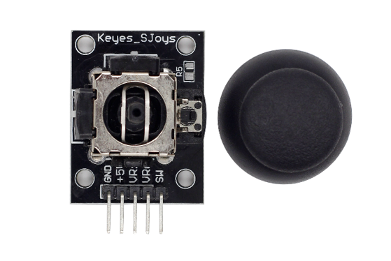
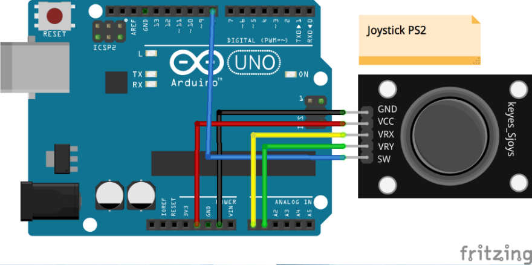

# Lekce 28: Joystick PS2

## Úvod

Joystick je vstupní zařízení sestávající z páčky, která se otáčí na základně a předává úhel nebo směr ovládacímu systému zařízení. Joysticky jsou často používány pro ovládání videoher a robotů. Zde je použit PS2 joystick.

<p align="center"></p>

## Komponenty

- Arduino
- USB kabel
- Joystick PS2
- Breadboard vodiče

## Princip

Tento modul má dva analogové výstupy (odpovídající souřadnicím X a Y) a jeden digitální výstup představující tlačítko na ose Z.

## Postup experimentu

**Krok 1:** Vytvoř obvod

<p align="center"></p>

| Joystick PS2 | Arduino |
|---|---|
| GND | GND |
| VCC | 5V |
| VRx (X) | A0 |
| VRy (Y) | A1 |
| SW | 8 |

**Krok 2:** Napiš kód do Arduino IDE

**Kód** – soubor `Joystick_PS2.ino`:

<!-- kod: Joystick_PS2/Joystick_PS2.ino -->
```cpp
/*
 * LaskaKit Arduino MAXI Starter kit – Lekce 28: Joystick PS2
 *
 * V sériovém monitoru (9600 Bd) vidíš polohu joysticku v osách X a Y
 * (0–1023, ve středu kolem 512) a stav tlačítka Z (0 = stisknuto).
 *
 * Zapojení:
 *   Joystick: GND–GND, +5V–5V, VRx–A0, VRy–A1, SW–8
 *
 * Knihovny: žádné (jen Arduino IDE)
 * Desky:    Arduino UNO R3, Arduino UNO R4 WiFi, Arduino Mega 2560
 *
 * Verze návodu 3.0 (10/2026)
 * LaskaKit | https://www.laskakit.cz | podpora@laskakit.cz
 */

const int xPin = A0;
const int yPin = A1;
const int tlacitkoPin = 8;

void setup() {
  pinMode(tlacitkoPin, INPUT_PULLUP);  // tlačítko spíná na GND
  Serial.begin(9600);
}

void loop() {
  Serial.print("X: ");
  Serial.print(analogRead(xPin));
  Serial.print(" | Y: ");
  Serial.print(analogRead(yPin));
  Serial.print(" | Z: ");
  Serial.println(digitalRead(tlacitkoPin));
  delay(200);
}
```
<!-- /kod -->

**Krok 3:** Zkompiluj kód

**Krok 4:** Nahraj sketch do Arduina

Otevři sériový monitor (9600 baud) a hýbej joystickem – hodnoty X a Y se budou měnit (ve středu kolem 512). Stiskni joystick a hodnota Z se změní z 1 na 0.
