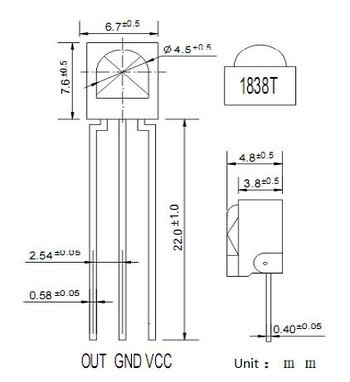
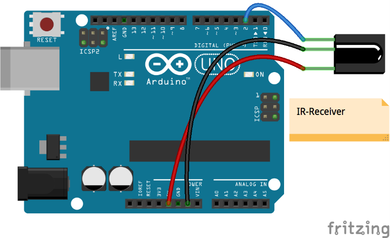

# Lekce 29: Infračervený přijímač

## Úvod

Hlavním prvkem tohoto infračerveného dálkového ovládání je přijímač HX1838. Tento infračervený přijímač umožňuje ve svém okolí detekovat signály z IR dálkových ovladačů a po jeho připojení k Arduinu můžeme tyto signály převést na proměnné a dále využít. V naší stavebnici je společně s přijímačem i dálkový ovladač, jehož tlačítkům můžeš v programu přiřadit libovolné funkce. Můžeš ale využít i jiné dálkové ovladače, které máš doma, třeba od televize či hi-fi věže.

<p align="center"></p>

## Komponenty

- Arduino
- USB kabel
- IR přijímač
- IR ovladač
- Breadboard vodiče
## Princip

Jako světelné zdroje se v dálkových ovladačích používají luminiscenční diody infra-LED emitující paprsek záření o vlnové délce kolem 950 nm. Při posílání informace způsobem log. 1 = „infra-LED svítí“, log. 0 = „nesvítí“ by bylo kvůli vysokému rušení obtížné zajistit bezchybný přenos datového rámce (zdrojem infračerveného záření je i slunce či obyčejná žárovka). Využívá se proto modulace.

Při modulaci logickou úrovní 1 se infra-LED budí obdélníkovým nosným signálem o dané střídě a frekvenci, typicky 30–56 kHz (v našem případě 38 kHz). Tento stav se nazývá značka. Po dobu logické úrovně 0 není dioda aktivní, nastává mezera. Dobu trvání značky a mezery, stejně tak jako jejich význam, specifikuje použitý protokol. V klidu, tj. když neprobíhá přenos rámce, setrvává vysílač ve stavu log. 0. Přijímač signálu je nastaven na použitý nosný kmitočet. Tím, že ostatní kmitočety odfiltruje, účinně zamezuje možnému rušení okolním světlem.

<p align="center"></p>

Když stiskneš klávesu Play/Pause, dálkový ovladač vyšle infračervené paprsky, přijímač je zachytí a LED na Arduinu se rozsvítí.

## Postup experimentu

**Krok 1:** Vytvoř obvod

| IR přijímač | Arduino |
|---|---|
| S | 2 |
| - | GND |
| + | 5V |

**Krok 2:** Napiš kód do Arduino IDE

> **Poznámka:** Potřebuješ knihovnu IRremote verze 4 nebo novější (autor Armin Joachimsmeyer) – viz kapitola Instalace knihoven. Starší programy s IRrecv a decode\_results s novou knihovnou nefungují.

**Kód** – soubor `Infracerveny_prijimac.ino`:

<!-- kod: Infracerveny_prijimac/Infracerveny_prijimac.ino -->
```cpp
/*
 * LaskaKit Arduino MAXI Starter kit – Lekce 29: Infračervený přijímač
 *
 * Přijímač HX1838 čte kódy z dálkového ovladače a vypisuje je do
 * sériového monitoru (9600 Bd). Tlačítko „Play/Pause“ (►||) rozsvítí
 * LED na pinu 13, jakékoli jiné tlačítko ji zhasne.
 * Kódy dalších tlačítek zjistíš v sériovém monitoru.
 *
 * Zapojení:
 *   IR přijímač: S–2, – na GND, + na 5V
 *   LED: vestavěná LED „L“ na pinu 13
 *
 * Knihovny: IRremote (Armin Joachimsmeyer) verze 4.x – Správce knihoven
 * Desky:    Arduino UNO R3, Arduino UNO R4 WiFi, Arduino Mega 2560
 *
 * Verze návodu 3.0 (10/2026)
 * LaskaKit | https://www.laskakit.cz | podpora@laskakit.cz
 */

#include <IRremote.hpp>

const int irPin = 2;
const int ledPin = 13;
const uint8_t KOD_PLAY = 0x43;  // tlačítko ►|| na ovladači ze stavebnice

void setup() {
  pinMode(ledPin, OUTPUT);
  Serial.begin(9600);
  IrReceiver.begin(irPin, DISABLE_LED_FEEDBACK);  // spustit příjem
  Serial.println("Mackej tlacitka na ovladaci...");
}

void loop() {
  if (IrReceiver.decode()) {
    // Opakovaný kód (tlačítko držíš) ignorujeme
    if (!(IrReceiver.decodedIRData.flags & IRDATA_FLAGS_IS_REPEAT)) {
      uint8_t kod = IrReceiver.decodedIRData.command;

      Serial.print("Protokol: ");
      Serial.print(getProtocolString(IrReceiver.decodedIRData.protocol));
      Serial.print(", kod tlacitka: 0x");
      Serial.println(kod, HEX);

      if (kod == KOD_PLAY) {
        digitalWrite(ledPin, HIGH);
      } else {
        digitalWrite(ledPin, LOW);
      }
    }
    IrReceiver.resume();  // připravit se na další kód
  }
}
```
<!-- /kod -->

**Krok 3:** Zkompiluj kód

**Krok 4:** Nahraj sketch do Arduina

Nyní stiskni tlačítko „Play“ na dálkovém ovladači a LED připojená k pinu 13 Arduina se rozsvítí. Stiskni libovolnou jinou klávesu a LED zhasne.

V sériovém monitoru (9600 baud) uvidíš kód každého stisknutého tlačítka. Kódy si můžeš zapsat a v programu jim přiřadit vlastní funkce.
