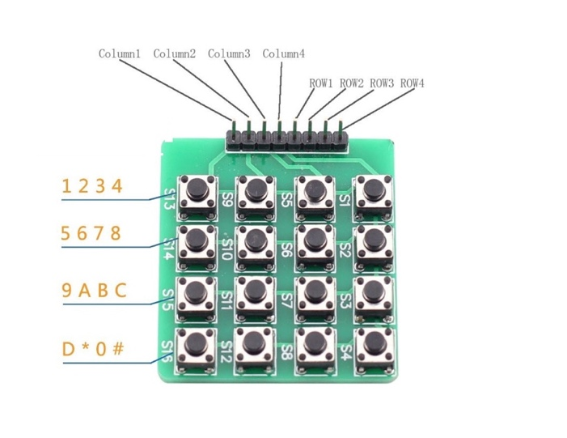
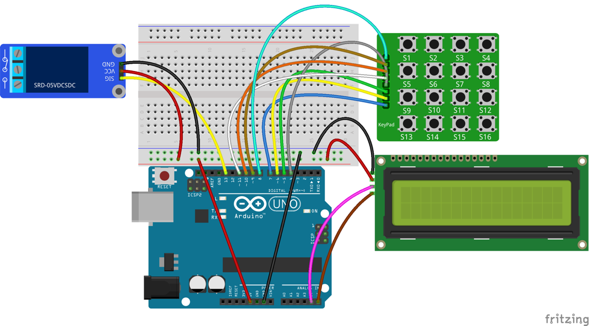

# Lekce 31: Vstupní ochranný systém s heslem

## Úvod

Teď, když už znáš tolik samostatných modulů, pojď je zkombinovat dohromady a vytvořit něco zábavného a interaktivního. V této lekci použijeme I2C LCD1602, modul relé a klávesnici k sestavení jednoduchého zámku na heslo. Zámek je založený na mikrokontroléru Arduino; podobná řešení se používají hlavně u bezpečnostních dveří.

## Komponenty

- Arduino
- USB kabel
- 1kanálový modul relé
- I2C LCD1602
- Maticová klávesnice 4×4
- Breadboard vodiče

<p align="center"></p>

## Princip

Heslo (výchozí 123456) je nastavené v programu. Po zapnutí se na displeji I2C LCD1602 objeví „Vitej!“ a relé je vypnuté. Stiskni tlačítko označené hvězdičkou „\*“, zadej heslo a potvrď ho tlačítkem „#“. Pokud je heslo správné, relé na 2 sekundy sepne a na displeji se objeví „Spravne!“ a „Vstup“. Pokud zadáš jiné heslo, objeví se „Chyba!“ a „Zkus to znovu“ a relé zůstane vypnuté. Po dvou sekundách se na displeji znovu objeví „Vitej!“.

POZNÁMKA: V programu jsou čtyři tlačítka v první řadě (s piny v horní části, jak vidíš na obrázku) nastavená jako 1, 2, 3, 4; ve druhé řadě jako 5, 6, 7, 8; ve třetí řadě jako 9, A, B, C; ve čtvrté řadě jako D, \*, 0, #.

## Postup experimentu

**Krok 1:** Vytvoř obvod

| I2C LCD1602 | Arduino |
|---|---|
| GND | GND |
| VCC | 5V |
| SDA | A4 (Mega: 20) |
| SCL | A5 (Mega: 21) |

Modul relé zapoj jako v lekci 25, jen signál S připoj na pin 13.

Zapojení mezi klávesnicí a Arduinem:

| Klávesnice | Arduino |
|---|---|
| Sloupec 1 | 7 |
| Sloupec 2 | 6 |
| Sloupec 3 | 5 |
| Sloupec 4 | 4 |
| Řádek 1 | 11 |
| Řádek 2 | 10 |
| Řádek 3 | 9 |
| Řádek 4 | 8 |

<p align="center"></p>

**Krok 2:** Napiš kód do Arduino IDE

> **Poznámka:** Potřebuješ knihovny Keypad a LiquidCrystal I2C – viz kapitola Instalace knihoven.

**Kód** – soubor `Vstupni_system_pomoci_hesla.ino`:

<!-- kod: Vstupni_system_pomoci_hesla/Vstupni_system_pomoci_hesla.ino -->
```cpp
/*
 * LaskaKit Arduino MAXI Starter kit – Lekce 31: Vstupní ochranný systém s heslem
 *
 * Stiskni „*“, zadej šestimístné heslo (výchozí 123456) a potvrď „#“.
 * Při správném hesle se na displeji ukáže „Spravne!“ a na 2 s sepne
 * relé. Při chybném hesle se ukáže „Chyba!“.
 * Klávesy jsou v programu očíslované po řádcích (1 2 3 4 / 5 6 7 8 /
 * 9 A B C / D * 0 #), když máš klávesnici vývody nahoru.
 *
 * Zapojení:
 *   Klávesnice 4×4: řádky R1–11, R2–10, R3–9, R4–8,
 *   sloupce C1–7, C2–6, C3–5, C4–4
 *   Modul relé: S–13, +–5V, ––GND
 *   I2C LCD1602: GND–GND, VCC–5V, SDA/SCL podle lekce 6
 *
 * Knihovny: Keypad (Mark Stanley, Alexander Brevig), LiquidCrystal I2C – Správce knihoven
 * Desky:    Arduino UNO R3, Arduino UNO R4 WiFi, Arduino Mega 2560
 *
 * Verze návodu 3.0 (10/2026)
 * LaskaKit | https://www.laskakit.cz | podpora@laskakit.cz
 */

#include <Keypad.h>
#include <Wire.h>
#include <LiquidCrystal_I2C.h>

LiquidCrystal_I2C lcd(0x27, 16, 2);

const int relePin = 13;
const int RELE_ZAPNUTO = HIGH;  // u modulů spínaných nulou změň na LOW

const byte RADKY = 4;
const byte SLOUPCE = 4;
char klavesy[RADKY][SLOUPCE] = {
  {'1', '2', '3', '4'},
  {'5', '6', '7', '8'},
  {'9', 'A', 'B', 'C'},
  {'D', '*', '0', '#'}
};
byte radkyPiny[RADKY] = {11, 10, 9, 8};
byte sloupcePiny[SLOUPCE] = {7, 6, 5, 4};
Keypad klavesnice = Keypad(makeKeymap(klavesy), radkyPiny, sloupcePiny, RADKY, SLOUPCE);

const char heslo[] = "123456";      // tajné heslo
const byte delkaHesla = sizeof(heslo) - 1;
char zadano[delkaHesla + 1];
byte pozice = 0;
bool zadavani = false;

void setup() {
  pinMode(relePin, OUTPUT);
  digitalWrite(relePin, !RELE_ZAPNUTO);
  lcd.init();
  lcd.backlight();
  zobrazVitej();
}

void loop() {
  char klavesa = klavesnice.getKey();
  if (!klavesa) return;  // nic nestisknuto

  if (klavesa == '*') {                 // začátek zadávání
    pozice = 0;
    zadavani = true;
    lcd.clear();
    lcd.print("Zadej heslo:");
    lcd.setCursor(0, 1);
  } else if (klavesa == '#') {          // potvrzení
    if (zadavani) over();
  } else if (zadavani && pozice < delkaHesla) {
    zadano[pozice] = klavesa;
    pozice++;
    lcd.print('*');                     // heslo na displeji schovat
  }
}

void over() {
  zadano[pozice] = '\0';
  zadavani = false;
  lcd.clear();
  if (pozice == delkaHesla && strcmp(zadano, heslo) == 0) {
    lcd.print("    Spravne!    ");
    lcd.setCursor(0, 1);
    lcd.print("     Vstup      ");
    digitalWrite(relePin, RELE_ZAPNUTO);
    delay(2000);
    digitalWrite(relePin, !RELE_ZAPNUTO);
  } else {
    lcd.print("     Chyba!     ");
    lcd.setCursor(0, 1);
    lcd.print(" Zkus to znovu  ");
    delay(2000);
  }
  zobrazVitej();
}

void zobrazVitej() {
  lcd.clear();
  lcd.print("     Vitej!     ");
  lcd.setCursor(0, 1);
  lcd.print("Stiskni *");
}
```
<!-- /kod -->

**Krok 3:** Zkompiluj kód

**Krok 4:** Nahraj sketch do Arduina

Nyní se na displeji I2C LCD1602 po zapnutí objeví „Vitej!“ a relé je vypnuté. Pokud stiskneš tlačítko „\*“, objeví se „Zadej heslo:“. Číslice se při psaní zobrazují jako hvězdičky. Pokud zadáš „123456“ a stiskneš „#“ pro potvrzení, objeví se „Spravne!“ a „Vstup“ a relé na 2 sekundy sepne. Pokud zadáš něco jiného, objeví se „Chyba!“ a „Zkus to znovu“ a relé zůstane vypnuté. Po dvou sekundách se znovu objeví „Vitej!“.
